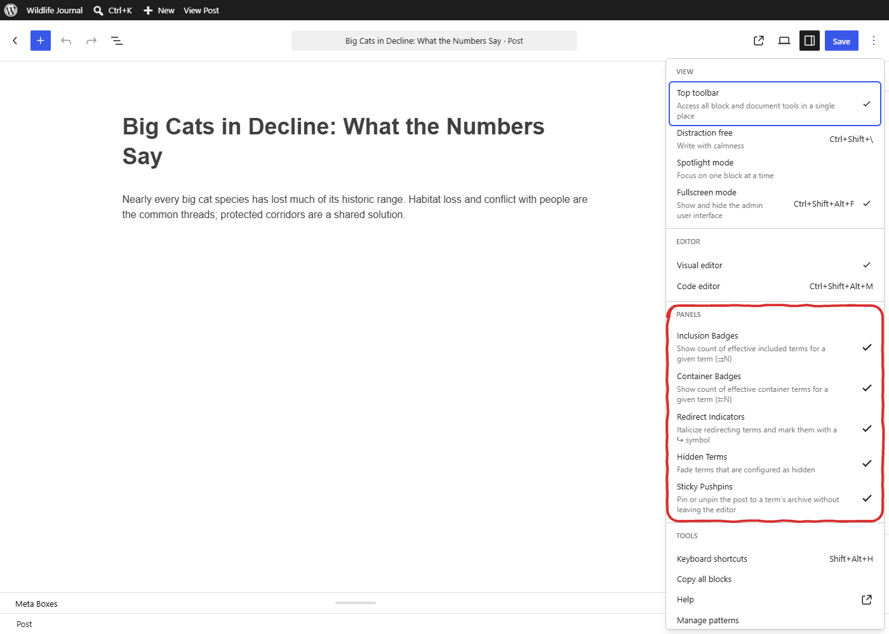
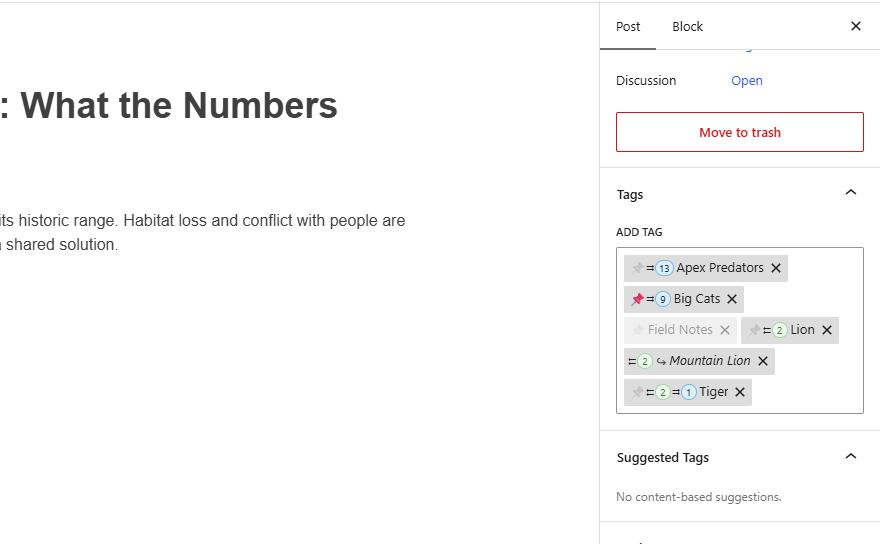

# Editing Posts

HyperTaxonomy can display contextual indicators directly in the Gutenberg and Classic post editors when you assign tags or categories to a post. Each indicator is controlled by a per-user toggle in the block editor's **··· menu** (More options) under the HyperTaxonomy group, and also requires the corresponding feature to be enabled on the taxonomy (Features → [Taxonomy]). Both the per-user toggle and the taxonomy feature must be on for an indicator to appear. Preferences persist per user and take effect immediately without saving. The toggles exist only in the block editor, so the Classic Editor always uses their defaults: Redirect Indicators and Hidden Terms on, the others off.

On first visit to the block editor, a dismissible notice explains that these toggles exist and where to find them.

## Tags Field

In the block editor, WordPress checks each tag you type or paste with the server and only adds it to the post once all the replies are back. On a slow site, tags entered during that wait can be lost. HyperTaxonomy prevents this for tags: entered tags are added once they've been checked, and the post's other tags are kept. Save and Publish are briefly disabled during the check. This is always on and doesn't apply to other taxonomies.

## Inclusion Badges and Container Badges

When enabled, each term pill (flat taxonomies) or checklist entry (hierarchical taxonomies) can show:

- **⇉ N** (light blue badge): This term's archive pulls in posts from N other terms. The tooltip lists their names. Appears when **Inclusion Badges** is on and the taxonomy has Term Relationships enabled.
- **⇇ N** (light green badge): N other terms pull in this term's posts. The tooltip lists those terms. Appears when **Container Badges** is on and the taxonomy has Term Relationships enabled.

These are informational — they help you understand the reach of a term before assigning it to a post.

## Redirect Indicators

When **Redirect Indicators** is on (default) and the taxonomy has Redirects enabled, redirect terms are displayed in italics with a ↪ symbol. Hovering the ↪ shows the redirect target name. This warns editors that assigning a redirect term points visitors away from that term's archive — the term's own archive does not serve posts.

## Hidden Terms

When **Hidden Terms** is on (default) and the taxonomy has Visibility enabled, terms marked as hidden are displayed at reduced opacity. This signals that the term is not publicly visible on the frontend.

## Sticky Pushpins

When **Sticky Pushpins** is enabled in the ··· menu and the taxonomy has Archive Customization enabled, a 📌 pushpin icon appears inline next to each term in the post editor's tag/category fields. Clicking the pushpin toggles the post's sticky status for that term's archive without leaving the editor.

- A filled pushpin (📌) means the post is currently pinned to that term's archive.
- A faded pushpin means the post is not pinned.
- Redirect terms are excluded — their archives redirect away, so pinning has no visible effect.
- If a term is removed from the post, it is automatically unpinned.
- The pin is per-term: a post can be sticky for one term but not another.
- The post must be published for sticky pinning to take effect on the frontend.
