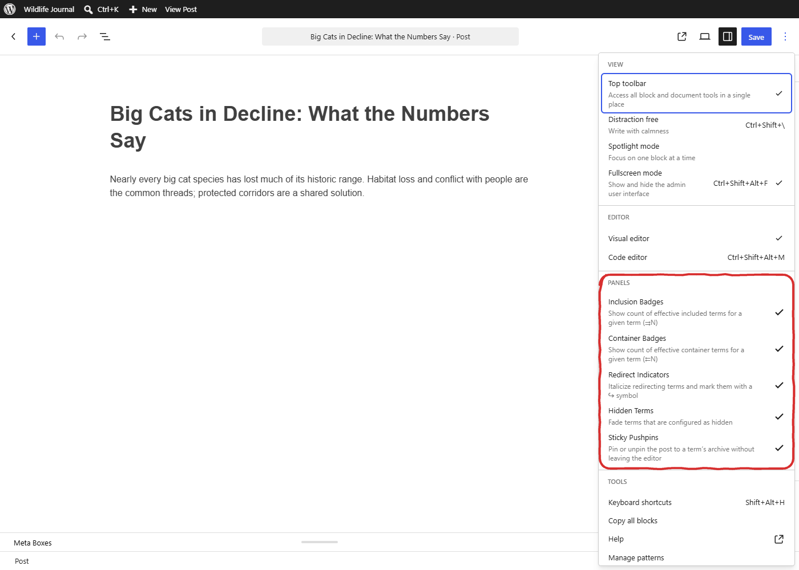
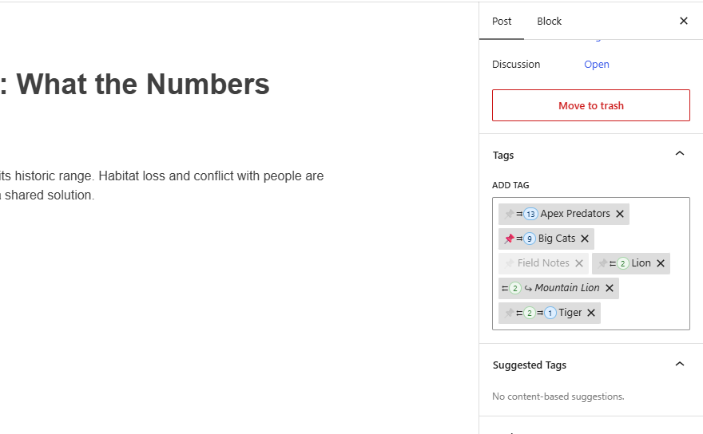

# Editing Posts
{: .no_toc }

When you assign tags or categories to a post, HyperTaxonomy keeps tags you enter from being lost, can restrict them to existing tags and suggest terms from the post's content, and can display contextual indicators in the Gutenberg and Classic post editors.

## Table of contents
{: .no_toc .text-delta }

1. TOC
{:toc}

---

## Tags Field

In the block editor, WordPress checks each tag you type or paste with the server and only adds it to the post once all the replies are back. On a slow site, tags entered during that wait can be lost. HyperTaxonomy prevents this for tags: entered tags are added once they've been checked, and the post's other tags are kept. Save and Publish are briefly disabled during the check. This is always on and doesn't apply to other taxonomies.

### Restricting to Existing Tags

With **Post Editor Restrictions** on ([Settings&nbsp;→ HyperTaxonomy&nbsp;→ Advanced](plugin-settings.html#advanced-tab)), editors can only add tags that already exist, which guards against misspelled or duplicate tags. Existing tags can be picked from autocomplete, typed, or pasted, including several at once. In the block editor, a new tag is refused with a message and removed from the field, and any existing tags entered with it are still added. In the Classic Editor, existing tags save normally and new ones are left off when the post is saved, with a notice listing them. A name must match an existing tag exactly: "OBrien" counts as new even if "O'Brien" exists. In the block editor, a tag with a backslash in its name has to be picked from autocomplete. Quick Edit, Bulk Edit, the Tags screen, imports, other plugins, and other REST API clients can still create tags.

## Content-Based Tag Suggestions

With **Content-Based Tag Suggestions** on (the default, in [Settings&nbsp;→ HyperTaxonomy&nbsp;→ Advanced](plugin-settings.html#advanced-tab)), the block editor sidebar shows a **Suggested** panel, such as **Suggested Tags**, right after each flat taxonomy's own panel, for every flat taxonomy HyperTaxonomy is enabled for. It takes the place of WordPress's "most used" list for that taxonomy. Suggestions are drawn from terms not already assigned to the post, ranked by how often each term's name appears in the title (shown first), excerpt (shown second), or body (shown third), with count descending within each group. A **Words to ignore** field accepts a comma-separated list of words that are stripped from the post text before matching — useful for excluding generic terms like "post" or "page" that would otherwise produce false matches.

## Turning Indicators On and Off

Each indicator is controlled by a per-user toggle in the block editor's **··· menu** (More options) under the HyperTaxonomy group, and also requires the corresponding feature to be enabled on the taxonomy ([Features](plugin-settings.html#features-tab)&nbsp;→ [Taxonomy]). Both the per-user toggle and the taxonomy feature must be on for an indicator to appear. Preferences persist per user and take effect immediately without saving. The toggles exist only in the block editor, so the Classic Editor always uses their defaults: Redirect Indicators and Hidden Terms on, the others off.

On first visit to the block editor, a dismissible notice explains that these toggles exist and where to find them.

## Inclusion Badges and Container Badges

When enabled, each term pill (flat taxonomies) or checklist entry (hierarchical taxonomies) can show:

- **⇉ N** (light blue badge): This term's archive pulls in posts from N other terms. The tooltip lists their names. Appears when **Inclusion Badges** is on and the taxonomy has Term Relationships enabled.
- **⇇ N** (light green badge): N other terms pull in this term's posts. The tooltip lists those terms. Appears when **Container Badges** is on and the taxonomy has Term Relationships enabled.

These are informational — they help you understand the reach of a term before assigning it to a post. [Term Relationships](term-relationships.html) explains how terms include each other.

## Redirect Indicators

When **Redirect Indicators** is on (default) and the taxonomy has Redirects enabled, [redirect terms](term-relationships.html#redirects) are displayed in *italics* with a ↪&nbsp;symbol. Hovering the ↪&nbsp;shows the redirect target name. This warns editors that assigning a redirect term points visitors away from that term's archive — the term's own archive does not serve posts.

## Hidden Terms

When **Hidden Terms** is on (default) and the taxonomy has Visibility enabled, terms [marked as hidden](per-term-settings.html#term-visibility) are displayed at reduced opacity. This signals that the term is not publicly visible on the frontend.

## Sticky Pushpins

In the block editor, when **Sticky Pushpins** is enabled in the ··· menu and the taxonomy has Archive Customization enabled, a 📌 pushpin icon appears inline next to each term in the post editor's tag/category fields. Clicking the pushpin toggles the post's [sticky status](per-term-settings.html#sticky-posts) for that term's archive without leaving the editor.

- A filled pushpin (📌) means the post is currently pinned to that term's archive.
- A faded pushpin means the post is not pinned.
- Redirect terms are excluded — their archives redirect away, so pinning has no visible effect.
- If a term is removed from the post, it is automatically unpinned.
- The pin is per-term: a post can be sticky for one term but not another.
- The post must be published for sticky pinning to take effect on the frontend.
- Pins are shown only to users who can pin posts (the `manage_term_sticky_posts` capability; Administrators and Editors by default — see [Roles & Permissions](roles-permissions.html)).
