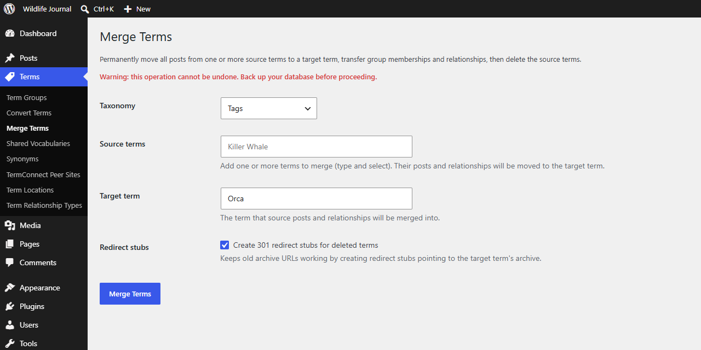

# Merge & Convert Terms

Two operations for permanently changing a term's identity rather than just its relationships:

| Operation | What changes | Term deleted? |
|-----------|-------------|---------------|
| **Merge** | Posts and relationships move from source term(s) to a target term | Yes — source terms deleted |
| **Taxonomy conversion** | A new term is created in another taxonomy, and the posts move to it | Only without a redirect stub; with one, the old term stays as the stub |

Both operations can create **redirect stubs** ([redirects](term-relationships.html#redirects) from the old terms) so old archive URLs continue to work. They treat [group memberships](term-groups.html) differently: a merge transfers them to the target, while a conversion leaves them on the redirect stub.

## Merge Terms

Permanently consolidate duplicate or outdated terms into a single canonical term. Posts, group memberships, relationships, and sticky posts from the source terms are transferred to the target, and the source terms are deleted.

**How to merge:**

1. Go to **Terms&nbsp;→ Merge Terms**, or use a row's **⧉&nbsp;Merge** link on the [Synonyms](term-relationships.html#the-synonyms-page) page, which fills in steps 2–4 for that pair
2. Select the **Taxonomy** the terms belong to
3. Type and select one or more **Source terms** (the terms to be deleted)
4. Type and select a **Target term** (the term to keep)
5. Leave **Create 301 redirect stubs for deleted terms** checked (the default, recommended), or uncheck it
6. Click **Merge Terms**

The **Source terms** field takes several terms: type a name, select it from the suggestions, then type the next. The terms you've selected are listed in the field, in gray, and a term already selected isn't added twice. **Target term** takes a single term. Changing the **Taxonomy** clears both fields. If you opened the page from the Synonyms page, the row's term is the source and its synonym the target; you can change either before merging.

**What happens:**

- All posts assigned to source terms are reassigned to the target term
- Group memberships from source terms are added to the target term
- Inclusions, exclusions, and custom relationship types involving source terms are transferred to the target term
- Posts pinned to a source term are pinned to the target term. The target's **Maximum sticky posts** still limits how many are shown at once
- Source terms are deleted. The target keeps its own icon, description, and visibility; those of the source terms aren't transferred

**Redirect stubs (recommended):** When enabled, a new redirect term is created with each source term's name and slug, pointing to the target. Old archive URLs (e.g. `/tag/old-name/`) then 301-redirect to the target's archive, preserving SEO value and preventing broken links. If the target term is itself a redirect, stubs point directly to the chain's final destination.

**Warning:** This operation is permanent and cannot be undone. Back up your database before merging.

**Comparison with redirects:** Redirects leave both terms in place and redirect the archive URL. Merging physically reassigns all post relationships and deletes the source term. Use redirects for temporary or reversible consolidation; use merge for permanent cleanup.

## Convert Terms

**Terms&nbsp;→ Convert Terms** moves terms from one taxonomy to another. A fresh term is created in the target taxonomy and all post assignments are moved to it. What happens to the old term depends on whether you choose to leave a redirect stub.

**How to convert:**

1. Open **Terms&nbsp;→ Convert Terms**.
2. Choose a source taxonomy. The term list loads automatically.
3. Check the terms you want to convert. Use **Select all / Deselect all** as needed.
4. Choose the target taxonomy.
5. Leave **Create 301 redirect stubs in the old taxonomy** checked (the default), or uncheck it (see below).
6. Click **Convert Selected Terms**.

The term list shows each term's post count, with child terms indented under their parents. Checking a parent doesn't check its children: only the terms you check are converted. When you convert a parent together with its children, the parent is converted first.

**Limitations before converting:**

- If a term with the same name already exists in the target taxonomy, that term is skipped with an error. Rename one of them, then convert again.
- Terms that are already redirect stubs cannot be converted — remove the redirect on the term edit screen first.
- The site's default category cannot be converted — change the default in Settings&nbsp;→ Writing first.
- A term whose `term_group` value (WordPress's own way of marking terms as aliases of each other) is already used by a different term in the target taxonomy cannot be converted, because the two would become aliases there. This only affects terms created as aliases, which is rare; change the `term_group` first.

**With redirect stubs (default):**

The old term stays in the old taxonomy and becomes the redirect stub — it keeps its original slug so existing archive URLs (`/category/example/`) continue to work and redirect to the new taxonomy archive. The stub keeps its group memberships, inclusion relationships, and parent-child position in the hierarchy. The new term in the target taxonomy takes the old term's hidden status and sticky posts, and its icon if both taxonomies use the same icon dimensions. It has no group memberships or relationships.

**Without redirect stubs:**

The old term is deleted and its original URL slug is assigned to the new term, giving the new taxonomy archive a clean URL. The new term takes the old term's hidden status and sticky posts, and its icon if both taxonomies use the same icon dimensions. Group memberships and relationships are lost. Old archive URLs become 404s.

**Reversible conversions (redirect case only):** Converting a term back to the original taxonomy automatically detects the redirect stub and unwinds the conversion — posts are moved back to the stub (which regains its original role as a normal term), and the replacement term is deleted.

**Slugs:** The new term's slug is auto-generated when a redirect stub is created (the stub needs the original slug for URL routing). Without a redirect stub, the new term receives the original slug.

**Integration with other tools.** HyperTaxonomy also tracks conversions made by the [Categories to Tags Converter](https://wordpress.org/plugins/wpcat2tag-importer/) and other plugins that use the standard WordPress term-creation and term-deletion hooks. For those conversions, redirect stubs, hidden status, icons, and sticky posts are handled automatically. Direct database manipulation bypasses all hooks and is not tracked.
