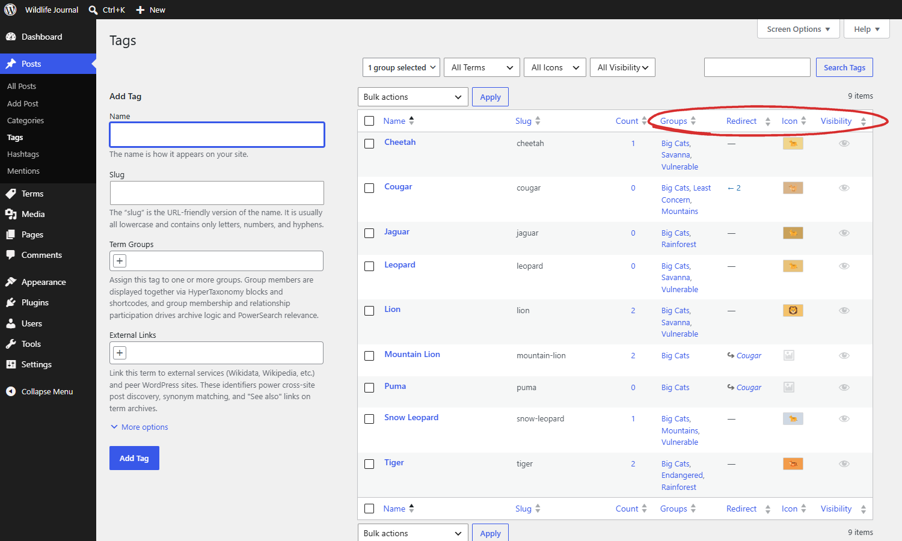
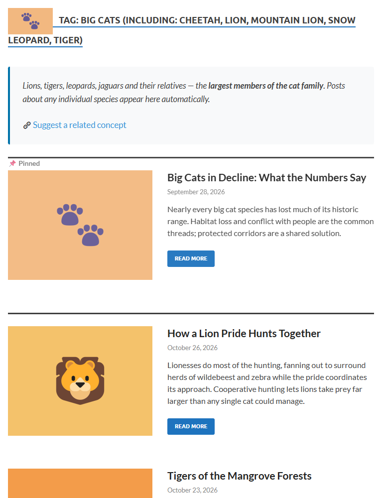

# Per-Term Settings
{: .no_toc }

Settings that apply to individual terms independently of their relationships — visibility, icons, descriptions, sticky posts, and archive overrides.

## Table of contents
{: .no_toc .text-delta }

1. TOC
{:toc}

---

## Term Visibility

Mark individual terms as **hidden** to use them for internal organization without public exposure.

**What hidden terms do:**

- Their archive URLs return 404 to unauthorized users (prevents term discovery)
- Excluded from term list and term index display shortcodes for **all users** (these are public navigation surfaces)
- Excluded from archive filter panels for **all users**
- In the search widget, offered as options (pills, checkboxes, autocomplete suggestions) only to users who can see hidden terms, so editors can search with them while visitors never see them
- Left out of the related terms HyperTaxonomy shares with other tools for **all users**: the relationship fields in the REST API (included terms, synonyms, relationships, redirect targets) and the [term meta](../developer-reference/term-meta.html) that GraphQL plugins and page builders read. WP-SKOS, when active, leaves them out of its vocabularies the same way
- Don't match in PowerSearch, search widget or post list results for unauthorized users (a search for the hidden term finds nothing, while posts carrying it are still found through their other terms); users who can see hidden terms can search by them
- Stay in the search index like any other term, kept up to date on the same events: each index row records whether a hidden term is involved, and hiding or unhiding a term only updates that flag, so searches switch over immediately without a reindex
- For unauthorized users, treated as if the term did not exist in Query Loop blocks, Latest Posts blocks, the REST API, and all other frontend post queries: filtering by a hidden term finds nothing, but posts that carry a hidden term still appear through their other terms (and in lists that don't filter by term)
- Excluded from REST API and XML sitemaps for unauthorized users (exception: under "Visible to all users", sitemaps include hidden terms because sitemaps are not per-user)
- HyperTaxonomy inclusion relationships do not surface posts from hidden terms in other terms' archives for unauthorized users
- Inclusion relationships and redirects continue working normally for users with permission
- Under **Hidden from all users**, an Administrator gets the same 404 on the term's archive as a visitor, and can't preview it

Editing a post doesn't remove hidden terms the user can't see, which can happen under the "Hidden from all users" option or with a custom role: the post keeps those terms. Only someone who can see a hidden term can remove it from a post.

**Visibility setting** (Settings > HyperTaxonomy > Display > Hidden Terms):

| Setting | Who can see hidden terms |
|---------|-------------------------|
| Visible only to users who can edit posts (default) | Users with the `edit_posts` capability (Contributors, Authors, Editors and Administrators) |
| Visible to all users | Everyone (useful for testing only) |
| Hidden from all users | No one on the front end, not even Administrators |

This setting controls the front end, except in the places marked **all users** above, which hide hidden terms from everyone whatever it says. In wp-admin, including the post editor, users with the `manage_term_visibility` capability (Editors and Administrators by default) can always see hidden terms, whichever option is selected.

**Hierarchy cascade:** When a term is hidden, HyperTaxonomy automatically marks all its WP descendants as hidden too. This keeps visibility explicit — no runtime ancestor traversal is needed and the hidden state is reliable across archives, search, post lists, and REST API responses.

When making a hidden term visible again (via the term edit screen, Quick Edit, or the Make Visible bulk action), if the term has hidden descendants a confirmation modal appears: **"N descendant terms are also hidden. Make them visible too?"** Confirming cascades the make-visible operation to all descendants; declining leaves descendants hidden individually. The descendants are not restored automatically without this confirmation.

**Reparent and create cascade:** If a term is moved to be a child of a hidden parent, the term and all its own descendants are automatically marked hidden at save time. Similarly, creating a new term under a hidden parent immediately marks the new term hidden. No confirmation is requested in either case — making additional terms hidden is always safe.

**Enable per taxonomy:** Settings > HyperTaxonomy > Features > [taxonomy] > Visibility.

**Setting visibility:**
- **Term edit screen** — In the **Visibility** row, check or uncheck **Hide this term from public view**.
- **Quick Edit** — Click Quick Edit on any term row to toggle the "Hidden from public display" checkbox inline, without leaving the list.
- **Bulk actions** — Select multiple terms and choose **Make Hidden** or **Make Visible** from the Bulk Actions dropdown.

While any ancestor term is hidden, this checkbox on its descendants is disabled in the UI — make the ancestor visible first before you can individually reveal a descendant.

**Limitation — native WordPress category hierarchy:**

HyperTaxonomy's own inclusion expansion correctly excludes hidden terms for unauthorized users. The remaining gap is WordPress's native parent→child behavior for hierarchical taxonomies (categories): WordPress automatically folds child terms into a parent's archive query and HyperTaxonomy cannot intercept this. If a category is hidden, its posts still appear in its visible parent's archive — the category name is never exposed anywhere, but the content is reachable.

This limitation does not affect flat taxonomies (tags) or non-hierarchical custom taxonomies.

**Workaround:** Hide the parent category as well. A hidden category's archive returns 404, which prevents the content from being reached through that route.

---

## Term Icons

Upload a custom icon image for any term to display alongside it in shortcodes, search widgets, and theme templates.

**Setup:**

1. Configure icon dimensions in **Settings > HyperTaxonomy > Icons** for each taxonomy (width, height, border-radius style)
2. Edit any term (tag, category, or custom taxonomy term)
3. Click **Upload Icon** in the Term Icon field
4. Select or upload an image (see size rules below)
5. Save the term

**Image size rules:**
- **Exact dimensions** — accepted immediately.
- **Larger than configured dimensions** — a crop dialog opens. Drag the fixed-size selection rectangle to choose which region to use, then click **Crop & use**. The crop cannot be resized — only repositioned. Cancelling leaves the previous icon unchanged.
- **Smaller than configured dimensions** — rejected with an error message. Images smaller than the required size are not shown in the media library picker at all. Upload a larger source image.
- **SVG** — accepted at any size. If WordPress can read the SVG's natural dimensions (from `width`/`height` attributes or `viewBox`) and the proportions differ from the configured slot, a warning is shown — you can proceed or cancel. SVGs with unknown dimensions are accepted silently.

**Automatic file naming:** Icons are named after the term slug (e.g., `php.png` for a "PHP" tag). On name collision, the taxonomy is appended (`php-category.png`). Icons are automatically renamed when you change a term's slug or convert it to a different taxonomy.

**Icon sizes:** Three sizes are generated from your configured dimensions. The configured dimensions are the large (full) size; WordPress generates the smaller variants automatically after upload or crop. Medium and small size percentages default to 50% and 25% but can be configured independently per taxonomy in **Settings → HyperTaxonomy → Icons**. Changing the percentages regenerates the medium and small files from the existing uploaded icons without requiring re-upload:
- Large (configured dimensions) — for archive headers
- Medium (default 50% of large) — for lists
- Small (default 25% of large) — for pills and inline display

**Changing dimensions:** Changing icon dimensions in Settings clears all existing icon assignments for that taxonomy (image files are preserved; you need to re-assign them).

**Bulk actions:** Select multiple terms on the term list screen and choose **Remove Icon** to clear icons from all selected terms at once.

**Sortable columns:** The **Redirect**, **Icon**, **Visibility**, and **Groups** columns in the term list table are sortable. The first three default to descending on first click — putting terms *with* that attribute first — so you can immediately see all redirect terms, all terms with icons, or all hidden terms without relying on the filter dropdowns. The **Groups** column defaults to ascending (ungrouped terms first, then alphabetically by group name). The **Icon** and **Visibility** columns are hidden by default; enable them via **Screen Options** (top-right of the term list screen).

**Filter dropdowns:** The term list table provides filter dropdowns above the table. The **Redirect** dropdown offers: *All Terms*, *Non-Redirects* (terms that are not redirect sources — includes redirect targets), *Redirects*, *Auto-redirects*, and *Targets* (redirect targets only). The **Icon** dropdown offers: *All Icons*, *With Icons*, and *No Icons*. The **Visibility** dropdown offers: *All Visibility*, *Visible*, and *Hidden*. The **Groups** dropdown is a searchable checklist (with a native browser × to clear the search) that also appears in the **Assign to Term Groups** bulk action modal. Filter dropdowns for columns that are hidden via Screen Options are automatically hidden as well.

---

## Archive Descriptions

Enable **Show Description** on any term to display its description as formatted HTML below the archive title. This allows rich, styled introductory text on term archive pages.

[{: .screenshot-small}](../assets/images/screenshots/term-archive.png)

To enable: Edit a term, expand **More options**, and check **Show Description**. The term's description field (standard WordPress) is then rendered as HTML on the archive page — above any sticky posts, if present. Requires **Archive Customization** enabled for the taxonomy (Settings > HyperTaxonomy > Features) and **Archive Description** enabled on the Display tab.

The description field appears in the **More options** collapsible on both the Add New Term and Edit Term screens. Its helper text explains that the description can also be used for autocomplete suggestions and PowerSearch relevance matching, which depends on **Match term descriptions** in the Search tab (off by default).

---

## Sticky Posts

Pin specific posts to appear at the top of a term's archive page, regardless of date or relevance order. Works with any enabled taxonomy (tags, categories, or custom taxonomies) and any indexed post type (posts, pages, or custom post types).

**How it works:**
- Sticky posts are pinned at the top of page 1 and excluded from subsequent pages
- At most the term's **Maximum sticky posts** (or the global setting) are pinned; any further sticky posts appear in their normal position. Pagination accounts for the pinned posts, so no regular post is skipped
- Stickiness is per-term — a post can be sticky for specific terms without being sticky everywhere
- The post must actually be assigned to that term to be sticky in its archive
- Enable per taxonomy: Settings > HyperTaxonomy > Features > Archive Customization. **Sticky Posts** on the Display tab must also be on

**To make a post sticky for specific terms:**
1. Edit the post in the block editor
2. Enable **Sticky Pushpins** in the ··· menu → HyperTaxonomy group (if not already on)
3. Click the 📌 pushpin next to each term where this post should appear at the top — it turns filled when active
4. Update the post

**Maximum sticky posts per term:** Configurable per term in the term edit screen (Archive Settings → **Maximum sticky posts**). Leave blank to use the global setting (Settings → HyperTaxonomy → Display, default 10). The number pinned never exceeds the archive's posts per page.

---

## Archive Settings

Per-term archive overrides available on any enabled taxonomy's term edit screen (the **Archive Settings** section, shown when Archive Customization is enabled for that taxonomy):

| Setting | What it does |
|---------|-------------|
| **Posts per page** | Override the global WordPress posts-per-page for this term's archive. Leave blank to use the WordPress default. |
| **Maximum sticky posts** | Maximum number of sticky posts shown at the top of this term's archive. Leave blank to use the global maximum from Settings > HyperTaxonomy > Display. |
| **Sort order** | Default sort order for this term's archive. Click **+** to add criteria and drag them to change their order. Fields are date, last modified, title, author, comments, latest comment, latest activity, relevance, and ID. Leave empty to use the site default. Can be overridden at runtime via the `?htax_orderby=` URL parameter (e.g. from a `[ht_sort_order_options action="navigate"]` picker on the archive page). |

These settings apply to any enabled taxonomy (tags, categories, or custom taxonomies) — not just built-in ones.

