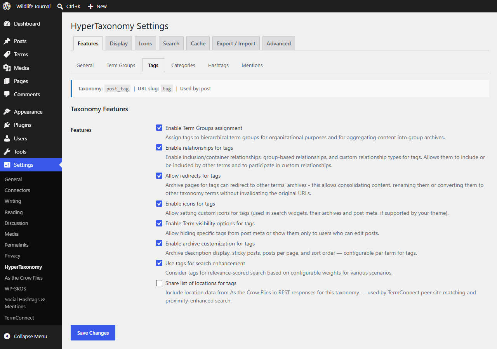
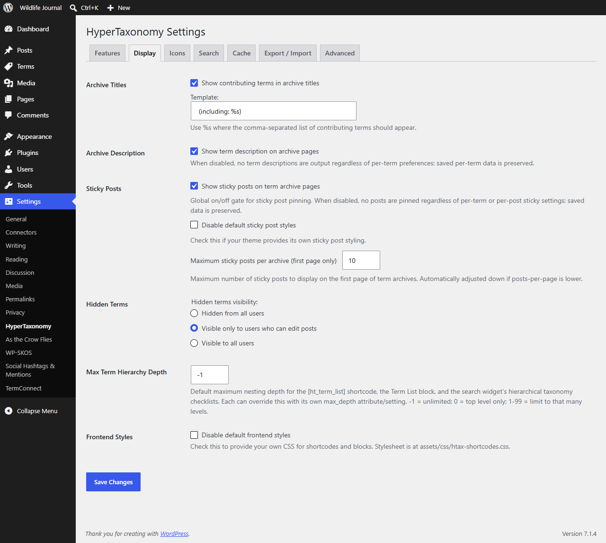
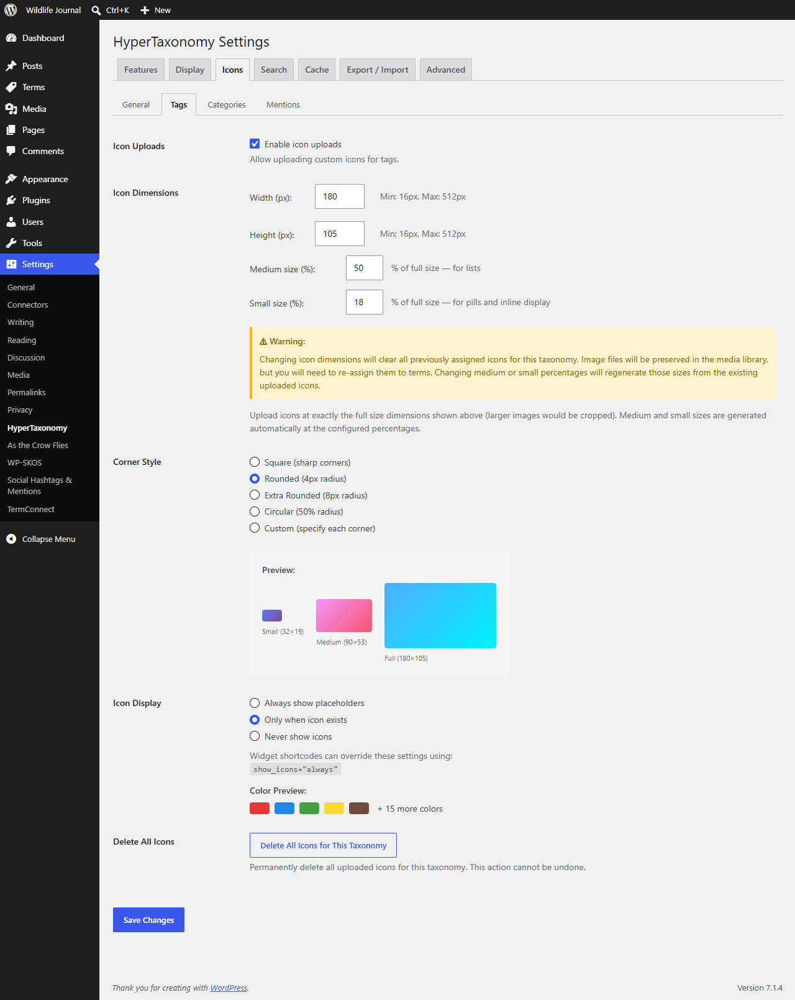
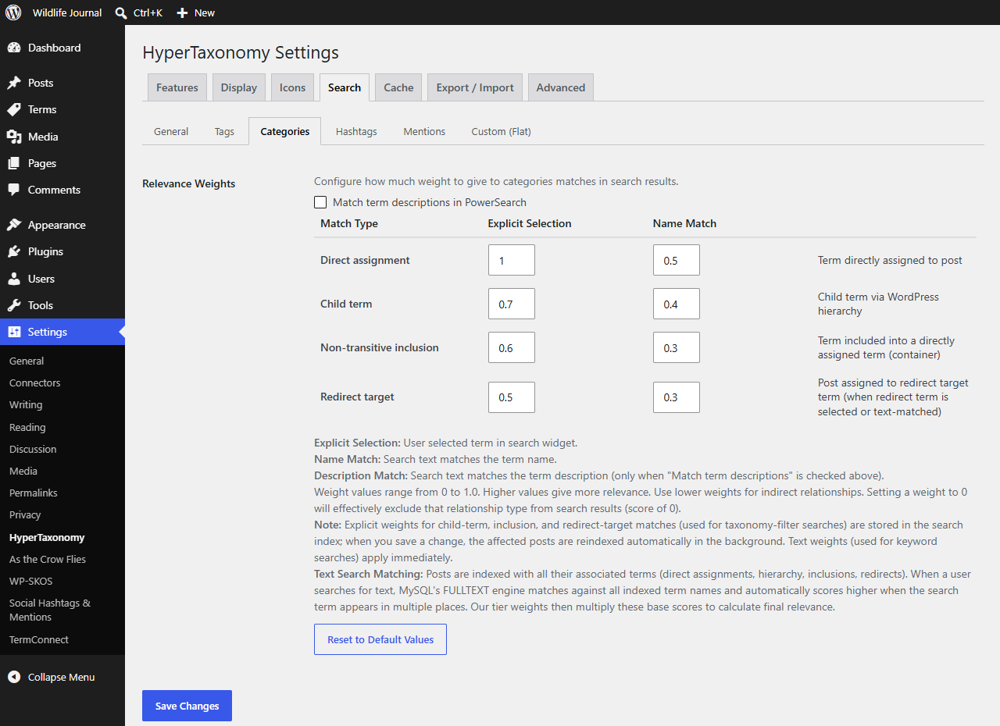
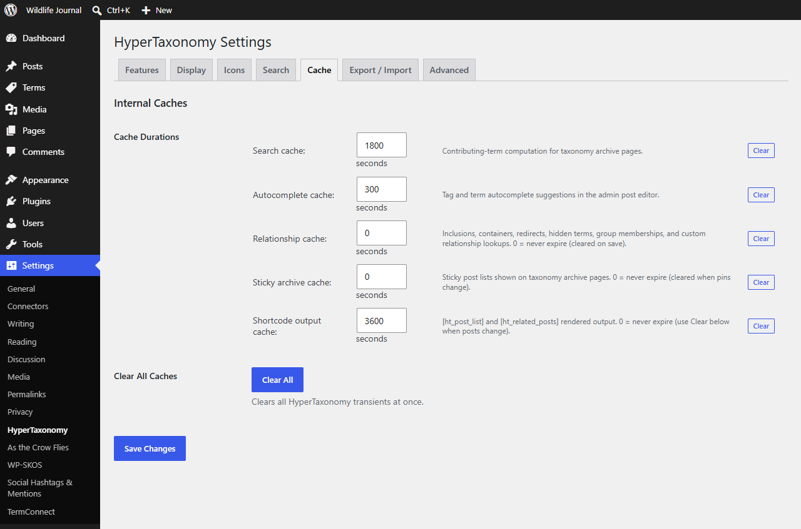
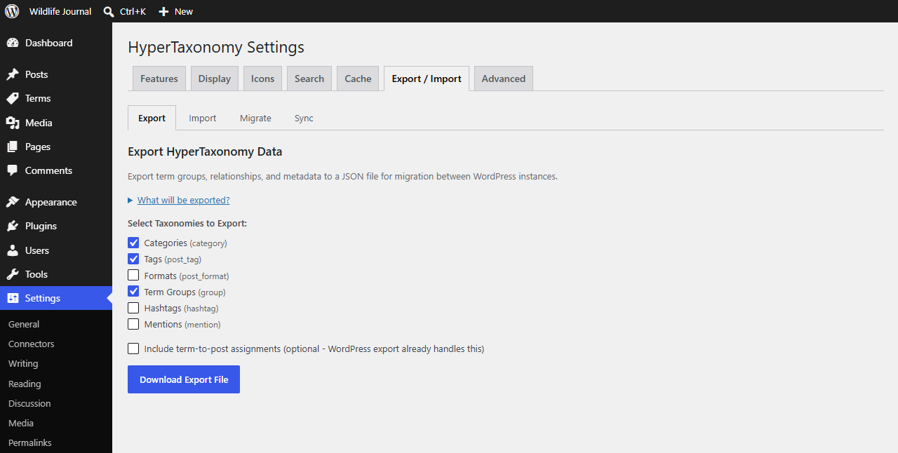
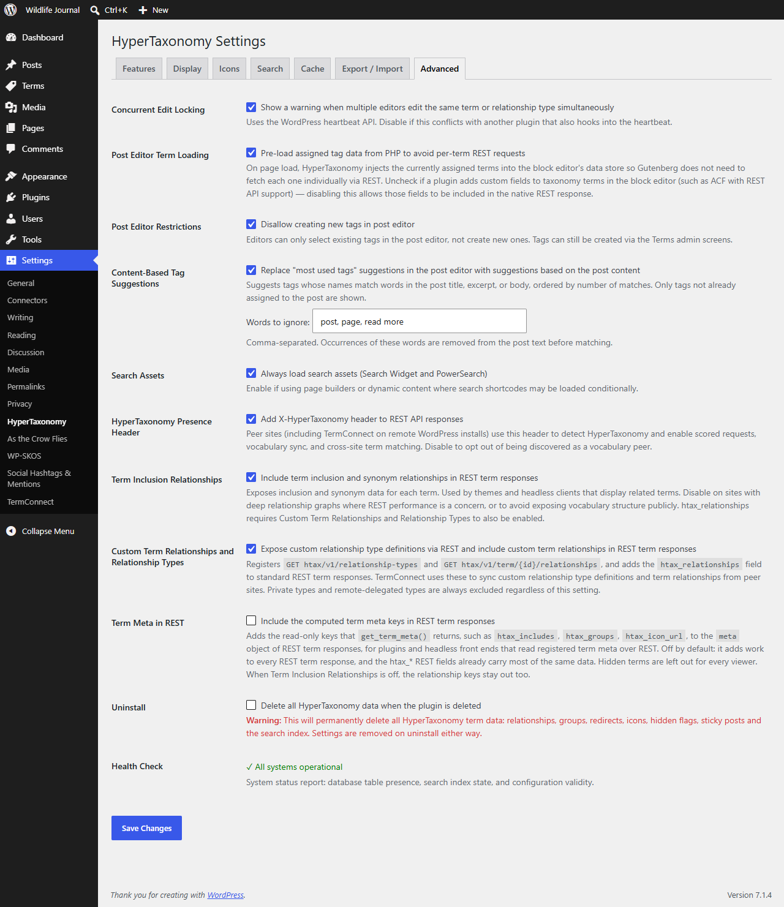

# Plugin Settings
{: .no_toc }

All settings are at **Settings&nbsp;→ HyperTaxonomy**, organized into tabs.

## Table of contents
{: .no_toc .text-delta }

1. TOC
{:toc}

---

## Features Tab

The main configuration hub. A **General** subtab controls which taxonomies HyperTaxonomy manages; additional subtabs appear for each enabled taxonomy (Tags, Categories, Term Groups, and any custom taxonomies).

**General subtab** — Enable or disable HyperTaxonomy for each available taxonomy via a checklist. Enabling a taxonomy activates its term edit fields and makes it available for all features below.

**Per-taxonomy subtabs** — Configure which features are active for that taxonomy. Each feature is a checkbox on screen, such as *Enable relationships for Tags*:

| Feature | What it enables |
|---------|----------------|
| Search Enhancement | Include this taxonomy in relevance-scored search ([PowerSearch](powersearch.html) and the [search widget](search-widget.html)), weighted by relationship type (direct assignment, child term, inclusion, redirect target). Enables per-taxonomy weight configuration in the Search tab. |
| Term Icons | [Icon upload per term](per-term-settings.html#term-icons); icons appear in search widgets, term archives, and post meta (theme support required). |
| Visibility | [Hide specific terms](per-term-settings.html#term-visibility) from visitors; the **Hidden Terms** setting on the Display tab decides who can still see them. |
| Redirects | [301 redirect support](term-relationships.html#redirects) for term archive pages. |
| Group Assignment | [Term Groups](term-groups.html) membership for this taxonomy (required for [Tag Groups / PublishPress Tag Groups import](export-import-migration.html)). Turning it off keeps the taxonomy's existing group memberships but ignores them: its terms drop out of group archives, group filters and group counts, and its [group inclusions and container groups](term-relationships.html#group-inclusions) stop applying. Turning it back on restores them; the search index catches up in the background. |
| Term Relationships | [Inclusion/container relationships](term-relationships.html), group-based relationships, and [custom relationship types](term-relationships.html#custom-relationship-types). When disabled, no archive expansion occurs for that taxonomy. |
| Archive Customization | Per-term archive description display, sticky posts, posts per page, and sort order (see [Per-Term Settings](per-term-settings.html)). |
| Share list of locations | When the [As the Crow Flies](https://wordpress.org/plugins/as-the-crow-flies/) plugin is active, HyperTaxonomy includes each term's locations from that plugin in this taxonomy's REST responses (`htax_locations`), for peer sites and other API clients. Proximity search and cross-site matching by location work without it. This row only appears when As the Crow Flies is active. |

## Display Tab

- **Archive Titles** — Optionally show which terms are contributing to an archive's title (e.g. "JavaScript (including: React)")
- **Archive Description** — Global gate for the per-term **Show Description** setting. When disabled, no term descriptions are output regardless of per-term preferences; saved per-term data is preserved.
- **Sticky Posts** — Global gate: when disabled, no posts are pinned regardless of per-term or per-post settings. When enabled, configure: *Disable default sticky post styles* (if your theme provides its own) and *Maximum sticky posts per archive* (first page only, default 10).
- **Hidden Terms** — Control who can see hidden terms on the frontend: hidden from all users, including Administrators; visible only to users who can edit posts (default); or visible to all users. Some places hide them from everyone regardless, such as term lists, search option lists and the related terms shared with other tools; see [Term Visibility](per-term-settings.html#term-visibility).
- **Max Term Hierarchy Depth** — Default maximum nesting depth for [`[ht_term_list]`](term-lists.html#ht_term_list), the Term List block, and the search widget's hierarchical checklists (`-1` = unlimited, `0` = top level only). Each can override this with its own `max_depth` attribute/setting.
- **Frontend Styles** — Disable the default frontend stylesheet (`assets/css/htax-shortcodes.css`), which applies to both shortcodes and blocks. Check this if providing your own CSS via a theme or custom stylesheet.

## Icons Tab

The Icons tab has a **General** subtab plus one subtab per taxonomy that has the Icons feature enabled.

**General subtab** — Theme integration reference: PHP code examples for displaying term pills with icons in single.php or archive.php, and a list of available template functions, documented in [Term Icons & Badges](../developer-reference/term-icons.html#term-icons-api) (`htax_the_term_pills`, `htax_the_archive_icon`, `htax_get_term_icon_html`, etc.).

**Per-taxonomy subtabs:**

- **Icon Uploads** — Enable or disable icon uploads for that taxonomy.
- **Icon Dimensions** — Width and height in pixels (16–512). These are the required upload dimensions — images smaller than this cannot be used; images larger trigger a crop dialog. Also configures Medium size (%) and Small size (%) as percentages of the full size, generated automatically on upload. Changing width or height clears existing icon assignments for that taxonomy; image files are preserved. Changing medium/small percentages regenerates those sizes from existing uploads.
- **Corner Style** — Border-radius preset for icons and pills: Square (0), Rounded (4px), Extra Rounded (8px), Circular (50%), or Custom (per-corner sliders 0–100%). A live preview shows small, medium, and full sizes at the current dimensions and corner style.
- **Icon Display** — Controls whether a colored placeholder appears when a term has no icon: Always show placeholders / Only when icon exists (default) / Never show icons. The shortcode `show_icons="always"` overrides this per-instance.
- **Delete All Icons** — Permanently deletes all uploaded icons for that taxonomy from the media library.

## Search Tab

The Search tab is only available when at least one taxonomy has Search Enhancement enabled in the Features tab. It has a **General** subtab plus one subtab per enabled taxonomy (and Custom Flat / Custom Hierarchical templates for custom taxonomies).

**General subtab:**

- **Indexed Post Types** — Which post types are included in the PowerSearch index and participate in HyperTaxonomy search features. Default: posts and pages (matching WordPress native search). Custom post types registered as public appear here and can be enabled individually.

- **Site Search Integration** — Replace WordPress's default `/?s=…` search with the PowerSearch engine (see [Native WordPress Search Override](powersearch.html#native-wordpress-search-override)). Applies relevance scoring, term relationship expansion, and field operators automatically. Disable if using Relevanssi, SearchWP, or another dedicated search plugin for the `/?s=` role.

- **Default Match Mode** — Controls how multi-word queries are treated when no `+` or `-` operators are used:
  - **Any (OR)** — posts matching at least one term are returned; more matches rank higher. Suitable for search forms where visitors build queries with other fields as well.
  - **All (AND)** — posts must contain every search term. Consistent with native WordPress search behavior; recommended for sites using HyperTaxonomy to replace native search. In All mode the `+` operator is redundant (every term is already required); only `-` exclusions and quoted phrases add behavior beyond a plain search.

  Applies to native WordPress search, and to the PowerSearch shortcode and the search widget's `[ht_text_field]` when they have no `match` attribute. Their `match` attribute overrides this setting per instance.

- **Term Relationship Expansion** — Which relationships a search for a term follows beyond the posts directly assigned to it. Each is on by default, and applies only in taxonomies where its feature is enabled:
  - **Container** — posts tagged with terms the searched term [includes](term-relationships.html#inclusions-and-containers), directly or through groups.
  - **Hierarchy** — posts in the searched term's child terms (hierarchical taxonomies).
  - **Redirects** — posts tagged with terms that [redirect](term-relationships.html#redirects) to the searched term. This works in one direction only: searching for a redirecting term finds just the posts tagged with it, since a redirect term's own inclusions are inactive.

  Applies to PowerSearch and the search widget; a widget field's `expand` attribute overrides it per field.

- **Search Result Order** — Default sort order for enhanced search results. Comma-separated `field:direction` pairs, e.g. `relevance:desc,date:desc`. Valid fields: `relevance`, `date`, `modified`, `title`, `author`, `comment_count`, `last_comment`, `last_activity`, `ID`.

- **Content Relevance Weights** — Multipliers (0–1) applied when scoring keyword matches against post fields:

  | Field | Default |
  |-------|---------|
  | Title match | 1.0 |
  | Content match | 0.8 |
  | Excerpt match | 0.7 |

  These weights multiply keyword matches in each post field when PowerSearch, site search, or a post list with keywords ranks results by relevance. Higher values give more importance to matches in that field.

- **Rate Limiting** — Maximum PowerSearch and search widget requests per minute (10–100), counted per logged-in user and, for visitors, per IP address. A request over the limit gets an error asking the visitor to wait. Protects against search abuse. On a site behind a proxy or CDN that hides visitors' addresses, all visitors share one limit unless a developer passes the real address with the `htax_rate_limit_client_ip` filter.

- **Third-Party Query Expansion** — When enabled, HyperTaxonomy automatically expands single-term taxonomy queries in secondary and third-party queries (such as listing widgets and loop builders) to reflect inclusion relationships; queries for several terms at once are left as they are (see [Expanding secondary queries](../developer-reference/query-expansion.html#expanding-secondary-queries)). Also enables [expansion-aware term counts](../developer-reference/query-expansion.html#expansion-aware-term-counts) wherever WordPress's own term counts are shown. Query expansion also applies to results loaded over AJAX; the counts are adjusted when the page loads. Facet plugins that filter with their own index (such as FacetWP) aren't affected. Disabled by default; enable if a facet or layered-navigation plugin is displaying counts or results that do not account for HyperTaxonomy inclusions.
- **Strength Model** — Which model's term strengths (how central each term is to a post) rank term-based search results and related posts. The built-in model, *HyperTaxonomy (term frequency)*, scores a term by how prominently its name appears in the post's title, excerpt, and body. Other plugins can provide their own models; each appears here with the share of post–term pairs it has scored, and can only be selected once it has scored all of them. While a provider's model is selected, pairs it hasn't scored yet (for example on a newly published post) don't contribute to term-based ranking until the provider scores them. The dropdown is disabled when only the built-in model is available. If the selected provider's plugin is deactivated, the built-in model is used automatically and a note under the dropdown says so; the provider's model takes effect again when its plugin is reactivated, and saving the Search tab meanwhile doesn't change the selection unless you change the dropdown. Models whose plugin is no longer active but which still have stored scores are listed as *inactive, stored scores only* — they can't be selected, but choosing one shows its coverage and a Clear Scores button so leftover scores can be removed. Relevance weights apply to every model.
- **Index Coverage** — For the built-in model: how many published posts are indexed, and the number of post–term pairs (directly assigned terms) in total and per taxonomy, with the number of index rows. For a provider's model: how many of those post–term pairs it has scored, in total and per taxonomy.
- **Index Rebuild** — For the built-in model: rebuilds the search index if results seem incorrect. A full rebuild keeps scores stored by providers' models. For a provider's model this becomes **Clear Scores**, which removes every score stored for that model (and switches the selection back to the built-in model if it was selected) — HyperTaxonomy can't recompute a provider's scores, so rescoring has to be done with that provider plugin's own tools.

**Relevance Weights sub-tabs** (one per enabled taxonomy, plus Custom Flat and Custom Hierarchical templates):

Each taxonomy's subtab shows a weight table with rows for each applicable relationship type. Which rows appear depends on the taxonomy:

| Row | Appears when |
|-----|-------------|
| Direct assignment | Always |
| Child term | Hierarchical taxonomies only |
| Non-transitive inclusion | Always (disabled if Term Relationships not enabled) |
| Redirect target | Redirects enabled for that taxonomy only |

Columns depend on the taxonomy type:

| Column | Purpose | Shown for |
|--------|---------|-----------|
| Explicit Selection | Propagation factor stored in the search index at index time. Determines how much of a direct term's relevance score flows to indirect relationships (hierarchy, inclusion, redirect). Saving a change automatically queues a background reindex of the affected posts (processed by WP-Cron); no manual rebuild is needed. | All taxonomies |
| Name Match | Weight applied dynamically when query text-matches the term name. Takes effect immediately without a rebuild. | Tags and Categories only |
| Description Match | Weight applied dynamically when query text-matches the term description. Hidden when "Match term descriptions" is unchecked. Takes effect immediately without a rebuild. | Tags and Categories only |

For custom taxonomies, Name Match and Description Match weights are configured in the **Custom (Flat)** and **Custom (Hierarchical)** template tabs rather than in the per-taxonomy subtab, which only shows Explicit Selection weights.

Until you save a subtab, its taxonomy uses the default weights the table shows; **Reset to Default Values** puts them back. The Explicit Selection defaults are 1.0 for direct assignment, 0.75 for inclusions and 0.6 for redirects in flat taxonomies such as Tags, and 1.0, 0.7 for child terms, 0.6 for inclusions and 0.5 for redirects in hierarchical ones such as Categories.

**Match term descriptions** checkbox (per taxonomy): when checked, search queries also match against term descriptions stored in `wp_term_taxonomy.description`, scored with the Description Match weights. When unchecked, the description branch is skipped in the query entirely — only term names are matched. Defaults to **off**. The Custom Flat and Custom Hierarchical template tabs set the default for newly enabled custom taxonomies; individual taxonomy tabs can override it.

Description Match weights are configured independently from Name Match weights. A common pattern is to use lower description weights (the defaults are roughly 70% of the corresponding name weight) since term names are typically a more precise signal than descriptions.

## Cache Tab

**Internal Caches**

- **Cache Durations** — Configurable transient expiration times. 0 = never expire (relies on automatic cache invalidation on save). Each row has an inline **Clear** button for that type:
  - *Search cache* — contributing-term computation for taxonomy archive pages (default 30 min). Its **Clear** button also clears the expansion-aware term counts
  - *Autocomplete cache* — term autocomplete suggestions on term edit screens and the Merge Terms page (default 5 min)
  - *Relationship cache* — inclusions, containers, exclusions, redirect targets, hidden terms, group memberships and custom relationship lookups (default: never expire)
  - *Sticky archive cache* — sticky post lists per term archive page (default: never expire)
  - *Shortcode output cache* — [`[ht_post_list]` and `[ht_related_posts]`](post-lists.html) query results: post IDs and totals, from which the HTML is rendered on each request (default 1 hour)
- **Clear All Caches** — Purges every HyperTaxonomy transient at once, including caches that have no duration of their own, such as the search widget's group-member maps. See [Caching](../architecture/caching.html).

## Export / Import Tab

- **Export** — JSON-based backup of HyperTaxonomy data (relationships, redirects, group memberships) for selected taxonomies
- **Import** — Restore from a previously exported JSON file
- **Migrate** — Import from Tag Groups (PublishPress Tag Groups). See [Export, Import & Migration](export-import-migration.html).
- **Sync** — How HyperTaxonomy stays in step with Tag Groups after migrating

## Advanced Tab

- **Concurrent Edit Locking** — Enable/disable the simultaneous-edit warning overlay on term edit screens. Uses the WordPress heartbeat API. Disable if it conflicts with another plugin that also hooks into the heartbeat.
- **Post Editor Term Loading** — Load a post's assigned tags from PHP, so the block editor shows them as soon as the Tags field appears and doesn't request each one over REST. Without this, typing in the field before the tags load replaces them. Disable if a plugin adds custom fields to terms in the block editor.
- **Post Editor Restrictions** — Optionally restrict editors to existing tags in the post editor, guarding against misspelled or duplicate tags. See [Editing Posts&nbsp;→ Restricting to Existing Tags](editing-posts.html#restricting-to-existing-tags).
- **Content-Based Tag Suggestions** — When enabled (default), the block editor suggests terms that appear in the post's content, in place of WordPress's "most used" list. **Words to ignore** takes a comma-separated list of words to leave out of the matching. See [Editing Posts&nbsp;→ Content-Based Tag Suggestions](editing-posts.html#content-based-tag-suggestions).
- **Search Assets** — *Always load search assets* forces the Search Widget and PowerSearch CSS/JS to load on every page. Enable only when using page builders or AJAX-loaded content where the shortcode may not be present on initial load.
- **HyperTaxonomy Presence Header** — Add the `X-HyperTaxonomy` header to REST API responses. Peer sites, including [TermConnect](https://hypertaxonomy.org/termconnect/) on remote installs, use it to detect HyperTaxonomy. Disable to opt out of being discovered as a vocabulary peer.
- **Term Inclusion Relationships** — Include inclusion and synonym data in REST term responses. Disable on sites with deep relationship graphs where REST performance is a concern, or to keep vocabulary structure private.
- **Custom Term Relationships and Relationship Types** — Expose custom relationship type definitions over REST, and include custom term relationships in REST term responses.
- **Term Meta in REST** — Add HyperTaxonomy's read-only [term meta keys](../developer-reference/term-meta.html), such as `htax_includes` and `htax_icon_url`, to the `meta` object of REST term responses, for plugins and headless front ends that read term meta over REST. Off by default, since it adds work to every REST term response. When **Term Inclusion Relationships** is off, the relationship keys stay out too.
- **Uninstall** — Option to delete all HyperTaxonomy data when the plugin is deleted. See [Deactivation & Uninstall](deactivation-uninstall.html#uninstall).
- **Health Check** — System status report: database table presence, search index state, and configuration validity.

