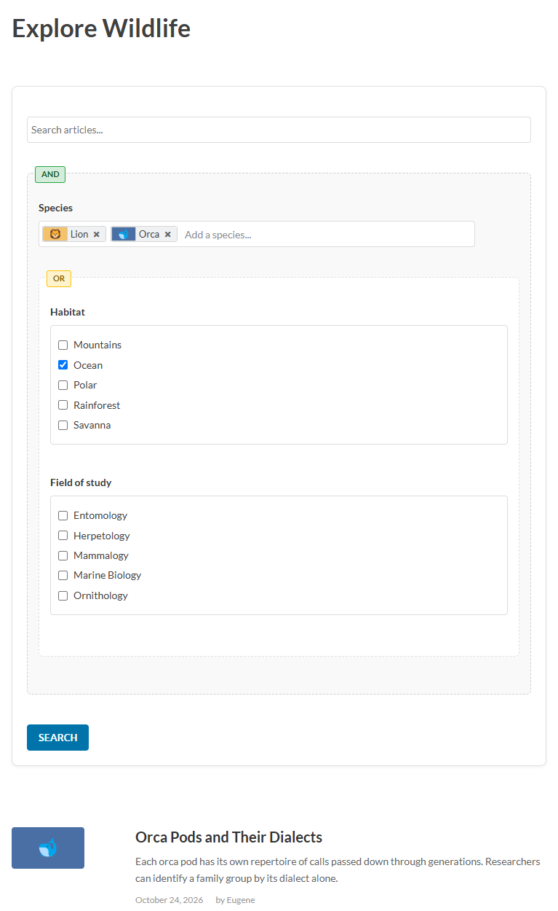

# Search Widget
{: .no_toc }

## Table of contents
{: .no_toc .text-delta }

1. TOC
{:toc}

---

## Advanced Search Widget

Build complex multi-field search forms with AJAX results, conditional logic, and taxonomy filtering. Composed of nested shortcodes inside `[ht_search_form]`.



- **Fields** — collect user input. `[ht_text_field]` captures a keyword; `[ht_pills_field]`, `[ht_checklist_field]`, and `[ht_hidden_field]` let users select taxonomy terms.
- **Field group** (`[ht_field_group]`) — groups fields, controllers, and other field groups under a single AND or OR logic container. Can be targeted by controller actions to show, hide, enable, or disable all its contents at once.
- **Controllers** (`[ht_search_controller]`) — present a set of options (radio buttons, checkboxes, a dropdown, etc.). Each option can carry one or more actions that fire when it is selected or deselected.
- **Controller actions** (`[ht_option_action]`) — each action targets a single field or field group and changes its state: selected terms, option pool, visibility, or enabled/disabled state. Multiple actions in one option all fire together.

### [ht_search_form]

Container for all search widget shortcodes.

| Parameter | Description | Default |
|-----------|-------------|---------|
| `id` | Form container ID (auto-generated if not specified) | — |
| `state` | Initial state: `expanded` or `collapsed` | `collapsed` |
| `ajax` | Container ID for AJAX results (empty = POST) | — |
| `action` | Form action URL for POST mode. Omit to POST to the current page; set to a URL (e.g. `/search`) to submit to a dedicated results page. See [POST mode results pages](#post-mode-results-pages). | — |
| `orderby` | Comma-separated `field:order` pairs. Fields: `relevance`, `date`, `modified`, `title`, `author`, `comment_count`, `last_comment`, `last_activity`, `ID`. Order: `asc` or `desc` (desc assumed if omitted). Example: `relevance:desc,date:desc,title:asc`. Both POST and AJAX modes support all fields. | `relevance:desc,date:desc` |
| `posts_per_page` | Results per page. Defaults to the WordPress **Blog pages show at most** setting (Settings → Reading). | WP setting |
| `max_results` | Hard cap on total results across all pages (0 = no cap). Set equal to `posts_per_page` to disable pagination. | `0` |
| `min_score` | Minimum overall relevance (0–1) | auto |
| `class` | Additional CSS classes | — |

`relevance` orders by taxonomy match count (weighted by relationship type and configured per-taxonomy weights).

### Field shortcodes

**`[ht_text_field]`** — Full-text keyword search. At most one per form; must be placed at the top level of `[ht_search_form]`, not inside `[ht_field_group]`. The text field filters the entire result set independently — it is not part of the AND/OR taxonomy group logic. Supports boolean operators: `+required`, `-excluded`, `"exact phrase"`. When As the Crow Flies is active it also accepts the PowerSearch proximity operators (`near:`, `-near:`) — see **Proximity operators** under [PowerSearch](powersearch.html#ht_power_search--powersearch-form); a text field holding only `near:` operators lists results nearest first under the default sort order.

**`[ht_pills_field]`** — Autocomplete pill-selector. With the default `suggest_on_focus="true"`, the dropdown opens as soon as the input is focused — no typing required. Set `suggest_on_focus="false"` to require at least one character before suggestions appear. With the default `prefetch="true"`, all options are loaded on page load and suggestions are filtered client-side:

- **0 characters** — top terms by post count.
- **1–2 characters** — prefix match, sorted by post count.
- **3+ characters** — substring match, natural order.

All states cap at 10 suggestions and exclude already-selected terms. The option pool must cover every term a visitor could pick from these suggestions, including those that only become visible under a specific controller state — `include_group_options` controller actions narrow the visible subset but never add terms outside the original pool. Only an `add_terms` action brings a term in from outside.

**`[ht_checklist_field]`** — Checkbox list rendered as a tree or flat alphabetical list. Can show individual taxonomy terms (the default) or subgroups as the selectable options — the latter is useful when you want users to filter by a category of terms without exposing every individual term.

**`[ht_hidden_field]`** — Submits a set of term IDs without any visible UI. There are no interactive elements; the selection can only be set via shortcode attributes or changed by controllers at runtime.

**Hidden terms.** Pills, checklist options and autocomplete suggestions include [hidden terms](per-term-settings.html) only for users who can see them (by default, users who can edit posts), and so do the results. Editors can search with hidden terms; visitors never see them as options and never match by them.

The three filter fields narrow `[ht_text_field]` results when a text field is present, or filter all site content when it is not. A filter panel works the same way with an AJAX search form: if nothing has been entered, changing a filter lists every post that matches it, newest first, and clearing the last filter empties the results area.

All field shortcodes require a `name` parameter and accept an optional `id` for the field's HTML element (auto-generated if not specified). The visible field shortcodes (`[ht_text_field]`, `[ht_pills_field]`, `[ht_checklist_field]`) additionally share:

| Parameter | Description | Default |
|-----------|-------------|---------|
| `label` | Visible label | — |
| `show_when` | `always`, `expanded`, `collapsed`, or `never` | `always` |
| `enabled` | `true` or `false` | `true` |
| `class` | Additional CSS classes | — |

Controllers share these same parameters — see [Controllers](#controllers--dynamic-field-population) below.

**`[ht_text_field]` parameters:**

| Parameter | Description | Default |
|-----------|-------------|---------|
| `search_in` | `all`, `title`, `content`, or `excerpt` | `all` |
| `default_value` | Pre-fills the field with a real value that is submitted with the form; once set, `placeholder` is never visible | — |
| `placeholder` | Grey hint text shown when the field is empty; hidden when the field has a value | — |
| `min_length` | Minimum character count; shorter input is rejected with a validation error (only enforced when the field is non-empty) | 3 |
| `min_length_message` | Validation message shown when input is shorter than `min_length` | built-in |
| `max_length` | Maximum character count (0 = no limit); enforced by the browser via the HTML `maxlength` attribute — excess characters on paste are truncated silently | 0 |

**Parameters common to `[ht_hidden_field]`, `[ht_pills_field]`, and `[ht_checklist_field]`:**

> The term option attributes (`include_term_options`, `exclude_term_options`, `add_terms`, `remove_terms`) accept term IDs **or** slugs (resolved within the field's `taxonomy`); the group option attributes (`*_group_options`, `*_descendant_options`, `add_groups`, `remove_groups`) accept group IDs or slugs (resolved within the `group` taxonomy). IDs and slugs may be mixed; a purely numeric token is treated as an ID.

| Parameter | Description | Default |
|-----------|-------------|---------|
| `taxonomy` | Taxonomy slug | `post_tag` |
| `taxonomy_type` | `post` (default) or `term`. Controls how group references are interpreted throughout the field — see table below. | `post` |
| `match` | `any` (OR), `all` (AND), or `none` (NOT IN). With `taxonomy_type="term"` the selection is groups: `any` matches posts in any selected group, `all` posts in every selected group, `none` excludes posts in any selected group (a post is "in" a group when it carries one of the group's member terms). | `any` |
| `expand` | Which relationship types are followed when expanding selected terms against the search index: `all` (use all types enabled by taxonomy feature flags — inclusions, hierarchy, redirects), `none` (direct matches only), or a comma-separated subset: `container`, `hierarchy`, `redirect`. | `all` |
| `filterby` | When `taxonomy_type="term"`: comma-separated post taxonomy slugs to expand submitted group IDs into at query time. Omit to expand across every HyperTaxonomy-enabled taxonomy that is attached to a post type. | — |
| `include_group_options` | **post:** member terms of these groups become the option universe. **term:** these group IDs themselves are the options. | — |
| `include_descendant_options` | **post:** member terms of all descendant groups become the option universe. **term:** descendant group IDs themselves are the options. | — |
| `include_term_options` | Comma-separated term IDs to include as options | — |
| `exclude_term_options` | Term IDs to exclude from the option pool entirely | — |
| `exclude_group_options` | **post:** member terms of these groups are excluded. **term:** these group IDs are excluded. | — |
| `exclude_descendant_options` | **post:** member terms of descendant groups are excluded. **term:** keep these groups as options but prune their subtrees. Applied before `exclude_term_options`. | — |
| `add_terms` | Term IDs to include in the field's initial selection. They join the option pool automatically (see below). | — |
| `add_groups` | **post:** include member terms of these groups. **term:** include these group IDs directly. | — |
| `add_descendants` | **post:** include member terms of all descendant groups (roots excluded). **term:** include all descendant group IDs (roots excluded). | — |
| `remove_terms` | Term IDs to remove from the initial selection | — |
| `remove_groups` | **post:** remove member terms of these groups. **term:** remove these group IDs. | — |
| `remove_descendants` | **post:** remove member terms of all descendant groups (roots excluded). **term:** remove all descendant group IDs (roots excluded). | — |
| `min_items` | Minimum selections required before the form can be submitted. When ≥ 1, the field label shows a `*` indicator (pills and checklist only — hidden fields have no label). | 0 |
| `max_items` | Maximum selections allowed (0 = unlimited) | 0 |

**`add_terms` and the option pool.** A term named by a field's own `add_terms` is part of its initial option pool, even if the declared pool doesn't cover it, and stays there. A term named by an `add_terms` action joins the pool when the action adds it, and leaves when a `remove_terms` action removes it or the option is deselected, unless it was in the initial pool. On a checklist, a term outside the rendered options appears as an extra option while it's in the pool: in name order among its siblings, under its parent if the parent is listed. The exceptions: a term in `exclude_term_options`, a deleted term, and a hidden term the visitor can't see are never added.

Terms from `add_groups` and `add_descendants` don't get this: they're added only if already in the declared pool, and otherwise skipped silently. See `not_found_message` on `[ht_option_action]` to surface skipped terms to users. A field with no declared pool accepts any existing term in its taxonomy.

All three field types follow the same `taxonomy_type` rules.

**`taxonomy_type` behavior summary:**

| | `taxonomy_type="post"` | `taxonomy_type="term"` |
|---|---|---|
| Selected values | Post taxonomy term IDs | Group/term IDs, expanded server-side at query time |
| Group references expand to | Member terms | The group IDs themselves |
| Descendant references expand to | Member terms of all descendant groups | Descendant group IDs |
| `filterby` | Not used | Comma-separated post taxonomies to expand into; omit for every HyperTaxonomy-enabled taxonomy attached to a post type |

**Group-descendant mode** — an advanced pattern that applies to all three filter fields. Set `taxonomy="group"` and `include_descendant_options` to a root group ID; each descendant group becomes a selectable option. At query time, each selected group is expanded to its member post-taxonomy terms. Use `filterby` to control which post taxonomy receives the expansion.

```
[ht_checklist_field name="spec" taxonomy="group"
    include_descendant_options="3"
    filterby="post_tag"
    hierarchical="false"
    show_when="never"]
```

- `include_descendant_options="3"` — show all descendants of group 3 as options; group 3 itself is excluded.
- `filterby="post_tag"` — expand each selected group into its `post_tag` member terms at query time. Multiple: `filterby="post_tag,category"`. Omit to expand across every HyperTaxonomy-enabled taxonomy attached to a post type.
- When a group is selected, posts must have at least one of its member terms. Deselecting everything disables the filter.

**Parameters common to `[ht_pills_field]` and `[ht_checklist_field]`:**

| Parameter | Description | Default |
|-----------|-------------|---------|
| `max_rows` | Cap visible height to this many rows, then scroll (0 = no cap) | 0 |
| `show_count` | Show post count next to each term | `false` |
| `show_icons` | `never`, `when_available`, or `always` | — |
| `min_items_message` | Validation message shown when fewer than `min_items` items are selected | — |
| `max_items_message` | Validation message shown when more than `max_items` items are selected | — |

**`[ht_pills_field]` parameters:**

| Parameter | Description | Default |
|-----------|-------------|---------|
| `placeholder` | Autocomplete input placeholder | — |
| `prefetch` | `true` loads the full option pool on page load; suggestions are filtered client-side. `false` fetches matching terms from the server on each keystroke — suitable for very large option pools where upfront loading would be too slow. | `true` |
| `suggest_on_focus` | `true` opens the suggestion dropdown immediately when the input is focused (even with no text typed). `false` requires at least one character before suggestions appear. | `true` |

**`[ht_checklist_field]` parameters:**

| Parameter | Description | Default |
|-----------|-------------|---------|
| `hierarchical` | Display in a nested tree (hierarchical taxonomies only) | `true` |
| `max_depth` | Maximum depth for hierarchical display (`-1` = unlimited, `0` = top level only) | `-1` |

### [ht_field_group]

Groups filter fields, controllers, and other `[ht_field_group]`s under a single AND/OR logic container.

| Parameter | Description | Default |
|-----------|-------------|---------|
| `relation` | `AND` or `OR` | `AND` |
| `name` | Optional identifier for targeting this group with controller actions | — |
| `show_when` | `always`, `expanded`, `collapsed`, or `never` | `always` |
| `class` | Additional CSS classes | — |

```
[ht_search_form]
    [ht_text_field name="keyword" search_in="all"]
    [ht_field_group relation="OR"]
        [ht_pills_field name="tags" taxonomy="post_tag"]
        [ht_checklist_field name="categories" taxonomy="category"]
    [/ht_field_group]
[/ht_search_form]
```

**Nesting groups:** place `[ht_field_group]` inside another `[ht_field_group]` to any depth — each opening tag is paired with its own closing tag.

```
[ht_search_form]
    [ht_field_group relation="AND"]
        [ht_pills_field name="species" taxonomy="post_tag"]
        [ht_field_group relation="OR"]
            [ht_checklist_field name="habitat" taxonomy="group" taxonomy_type="term"]
            [ht_checklist_field name="field" taxonomy="category"]
        [/ht_field_group]
    [/ht_field_group]
[/ht_search_form]
```

### [ht_search_submit]

Submit button for the search form.

| Parameter | Description | Default |
|-----------|-------------|---------|
| `text` | Button label | `"Search"` |
| `show_when` | `always`, `expanded`, or `collapsed` | `always` |
| `class` | Additional CSS classes | — |

```
[ht_search_submit text="Find Posts" class="my-button"]
```

### [ht_search_toggle]

Toggles the form between collapsed and expanded states. Fields with `show_when="expanded"` are hidden when the form is collapsed and shown when expanded; fields with `show_when="collapsed"` do the opposite. The button label swaps automatically between the two states.

| Parameter | Description | Default |
|-----------|-------------|---------|
| `text_collapsed` | Button label when the form is collapsed | `"Show advanced options"` |
| `text_expanded` | Button label when the form is expanded | `"Hide advanced options"` |
| `class` | Additional CSS classes | — |

```
[ht_search_toggle text_collapsed="Show filters" text_expanded="Hide filters"]
```

### [ht_distance_field] — Location-Based Distance Filter

Adds a distance filter to a search widget form that lets visitors narrow results by proximity (postal code or geolocation). Requires the [As the Crow Flies](https://wordpress.org/plugins/as-the-crow-flies/) (ATCF) plugin to be active. If ATCF is not active, site administrators see an admin notice in place of the field; the shortcode renders nothing for other users.

Must be placed inside `[ht_search_form]`.

| Attribute | Description | Default |
|-----------|-------------|---------|
| `name` | Field name submitted with the form | `htax_distance` |
| `radius` | Comma-separated radius values for the dropdown (in the selected unit) | `5,10,25,50` |
| `unit` | Distance unit: `miles` or `km` | `miles` |
| `country` | ISO country code for postal centroid lookup | `US` |
| `taxonomy` | Taxonomy slug to limit which terms are searched for matching locations | — |
| `filterby` | Alias for `taxonomy` | — |
| `no_location` | What to do with terms that have no location set: `include` (terms without a location pass through, showing their posts regardless of distance) or `exclude` (strict — only terms with a matching location within the radius are included) | `include` |
| `input` | Input method(s): `zip` (postal code input only), `geolocation` (standalone "Find nearby" button), or `zip,geolocation` (postal input with crosshair icon inside it) | `zip,geolocation` |
| `include_term_options` | Comma-separated term IDs or slugs — only these terms are candidates for distance matching | — |
| `exclude_term_options` | Comma-separated term IDs or slugs — these terms are excluded from distance matching | — |
| `include_group_options` | Comma-separated group term IDs — member terms of these groups are candidates | — |
| `exclude_group_options` | Comma-separated group term IDs — member terms of these groups are excluded | — |
| `include_descendant_options` | Root term ID or slug — all descendants are included as candidates | — |
| `exclude_descendant_options` | Root term ID or slug — all descendants are excluded from matching | — |
| `expand` | Relationship expansion for the resolved in-range terms. Same semantics as the `expand` parameter on `[ht_pills_field]` / `[ht_checklist_field]` / `[ht_hidden_field]`: `all` (feature-flag defaults), `none` (direct only), or comma-separated `container`, `hierarchy`, `redirect`. | `all` |

**Example — store finder:**

```
[ht_search_form id="store-finder"]
  [ht_distance_field taxonomy="retailer" radius="5,10,25,50" unit="miles" no_location="exclude"]
[/ht_search_form]
```

The `no_location="exclude"` setting means only retailer terms that have a physical location set in ATCF will ever appear in results — useful when every term is expected to have a location and you do not want unlocated terms showing up regardless of the user's distance selection.

**Expansion and term relationships:**

By default (`expand="all"`), when the distance filter resolves a set of in-range terms, HyperTaxonomy still follows the normal relationship graph — inclusions, hierarchy, and redirects — just as it would for a regular taxonomy field. For example, if *Main Street Bakery* includes *Main Street Bakery Express*, a search within 5 miles of the user will surface posts tagged with either term as long as *Main Street Bakery* has a location in range.

Use `expand="none"` to restrict results to posts directly tagged with the in-range terms only, ignoring inclusions and hierarchy. Use a comma-separated list to allow only specific relationship types:

```
[ht_distance_field taxonomy="retailer" radius="5,10,25" expand="none"]
[ht_distance_field taxonomy="retailer" radius="5,10,25" expand="container"]
[ht_distance_field taxonomy="retailer" radius="5,10,25" expand="container,hierarchy"]
```

**Geolocation UX (`input="zip,geolocation"` or `input="geolocation"`):**

When `input` includes `geolocation`, a crosshair icon appears inside the right edge of the postal input. Clicking it requests browser location permission. On success, the input is populated with the detected postal code (when available) or city name, and the icon turns gray — subsequent searches use the precise coordinates rather than the postal centroid. If the user then edits or clears the input, the icon reactivates and the stored coordinates are cleared so the typed postal code is used instead.

When `input="geolocation"` only (no postal input), a standalone "Find nearby" button triggers an immediate search using coordinates.

### Controllers — Dynamic Field Population

Controllers let users change what appears in other fields by making a selection. Useful for "show me tags relevant to this category" patterns.

```
[ht_search_controller type="radio" name="content_type" label="Content Type"]
    [ht_search_option value="news" label="News" default="true"]
        [ht_option_action type="include_group_options" target="tags" groups="1,2,3"]
    [/ht_search_option]
    [ht_search_option value="tutorials" label="Tutorials"]
        [ht_option_action type="include_group_options" target="tags" groups="4,5,6"]
    [/ht_search_option]
[/ht_search_controller]

[ht_pills_field name="tags" taxonomy="post_tag"]
```

**`[ht_search_controller]` parameters:**

| Parameter | Description | Default |
|-----------|-------------|---------|
| `type` | UI type: `radio`, `checkbox`, `toggle`, `dropdown`, `link`, `button` | `radio` |
| `id` | HTML element ID (auto-generated if not specified) | — |
| `name` | Unique field name (used by `[ht_option_action]` `target`) | — |
| `label` | Label shown above the controller | — |
| `required` | Show a `*` indicator (radio and dropdown only; for checkbox/toggle use `min_items` instead) | `false` |
| `min_items` | Minimum selections required (checkbox/toggle only); when ≥ 1 shows `*` automatically | 0 |
| `max_items` | Maximum selections allowed (checkbox/toggle only; 0 = unlimited) | 0 |
| `min_items_message` | Message shown when fewer than `min_items` options are selected (checkbox/toggle only) | — |
| `max_items_message` | Message shown when `max_items` is reached (checkbox/toggle only) | — |
| `show_when` | `always`, `expanded`, `collapsed`, or `never` | `always` |
| `enabled` | Whether the controller is initially enabled (`true`/`false`) | `true` |
| `inline` | Render options inline (`true`/`false`) | `false` |
| `class` | Additional CSS classes | — |

**`[ht_search_option]` parameters:**

| Parameter | Description | Default |
|-----------|-------------|---------|
| `value` | The value submitted when this option is selected | — |
| `label` | Display label | — |
| `default` | Pre-select this option on load (`true`/`false`) | `false` |

**`[ht_option_action]`** places an action inside an `[ht_search_option]`. When the option is selected the action fires; when it is deselected the action automatically reverses. Multiple actions per option are allowed and executed in a fixed priority order.

**Option pool actions** — restrict which terms appear as options in the target field (pills and hidden fields; a checklist's options are fixed when the page renders, apart from terms `add_terms` brings in):
`include_term_options`, `include_group_options`, `exclude_term_options`, `exclude_group_options`

**Selection actions** — add or remove items from the target field's selection:
`add_terms`, `add_groups`, `add_descendants`, `remove_terms`, `remove_groups`, `remove_descendants`

`add_groups` / `remove_groups` act on the groups' member terms in the field's taxonomy (for `taxonomy_type="term"` fields, on the groups themselves); membership is resolved when the page renders. `add_groups` and `add_descendants` only accept terms that are already in the target field's declared option pool; terms outside the pool are silently skipped (configure `not_found_message` to surface this). `add_terms` terms join the pool automatically. `remove_*` actions always succeed. `add_descendants` / `remove_descendants` expand each group ID to its descendant terms (checklist: traverses `data-parent-id` hierarchy; pills: uses the prefetched group map). Each action type is the automatic reversal of the other.

**Constraint actions:** `set_min_items`, `set_max_items`

**Visibility actions:** `set_show_when`, `enable`, `disable`

**Reset actions:** `clear`, `clearOptions`, `resetOptions`, `reset`, `resetAll`

**`[ht_option_action]` parameters:**

| Parameter | Description | Default |
|-----------|-------------|---------|
| `type` | Action type (see above) | — |
| `target` | Name of the field to act upon | — |
| `terms` | Comma-separated term IDs (for term-based actions) | — |
| `groups` | Comma-separated group IDs (for group-based actions) | — |
| `value` | Value to set (for `set_min_items`, `set_max_items`, `set_show_when`) | — |
| `not_found_message` | Message shown on this controller when an action adds nothing for some of its terms: `add_groups` / `add_descendants` terms outside the target field's option pool, or `add_terms` terms that were deleted, excluded by the field, or are hidden from this visitor. Cleared automatically when the action reverses. | — |

### Complete Example

```
[ht_search_form state="collapsed" ajax="search-results" orderby="relevance:desc,date:desc"]
    [ht_text_field name="keyword" placeholder="Search..."]
    [ht_search_toggle text_collapsed="Show filters" text_expanded="Hide filters"]
    [ht_pills_field name="tags" taxonomy="post_tag" label="Tags"
        placeholder="Type to search..." show_icons="when_available" show_when="expanded"]
    [ht_checklist_field name="categories" taxonomy="category"
        label="Categories" hierarchical="true" max_depth="2" show_when="expanded"]
    [ht_search_submit text="Search"]
[/ht_search_form]

[ht_search_results id="search-results"]
```

## [ht_search_results] — Shared AJAX Results Container

Used by both `[ht_search_form]` and `[ht_power_search]` in AJAX mode. Pagination, result count, and query scope are controlled by the form shortcode; this container controls display only.

Place it anywhere on the page. Set `ajax="container-id"` on the form shortcode and `id="container-id"` here to link them. Display parameters such as `format`, `show_thumbnail` and `image_size` mean the same as in [Post Lists → Common Parameters](post-lists.html#common-parameters).

| Parameter | Description | Default |
|-----------|-------------|---------|
| `id` | Must match `ajax=` on the form shortcode that targets this container | — |
| `template` | CSS template modifier applied to each result card | `default` |
| `show_thumbnail` | Show featured images (`div` format only) | `true` |
| `show_excerpt` | Show post excerpts (`div` format only) | `true` |
| `show_meta` | Show post metadata — date and author (`div` format only) | `true` |
| `image_size` | WordPress registered image size for thumbnails | `medium` |
| `columns` | Number of columns. `div` format: CSS grid. `ul`/`ol` format: CSS multi-column text flow. Collapses to 2 on tablet (≤ 768 px), 1 on mobile (≤ 480 px). | `1` |
| `format` | Output format: `div` (full article cards), `ul` (unordered title-link list), or `ol` (ordered title-link list) | `div` |
| `prepend` | HTML template inserted before each result item. Supports post placeholders: `{id}`, `{title}`, `{url}`, `{date}`, `{modified}`, `{author}`, `{excerpt}`, `{comment_count}`, `{thumbnail}`, `{thumbnail:size}`. | — |
| `append` | HTML template inserted after each result item. Same placeholders as `prepend`. | — |
| `no_results_message` | HTML shown when no results are found | — |
| `sort_order_options` | Comma-separated field slugs for a sort order picker. Changing the sort re-runs the search. Empty = no picker. | — |
| `sort_order_align` | Alignment of the sort picker: `left`, `right`, or `center`. | — |
| `filters` | Inline filter panel keywords (see [Archive & Results Controls](archive-controls.html)). | — |
| `filter_options` | Per-position options aligned to `filters` (see [Archive & Results Controls](archive-controls.html)). | — |
| `filters_align` | Alignment of the filter panel: `left`, `right`, or `center`. | — |
| `class` | Additional CSS classes | — |

## POST mode results pages

A search widget or PowerSearch form without an `ajax` container submits the search to the page (POST mode) and shows the results with the theme's search template. The submission is answered with a redirect to a results URL carrying a short token — `…/?htax_q=…` — that holds the search. Because the results page is an ordinary link:

- the theme's page links (`/page/2/?htax_q=…`) page through the whole result set, using the form's `posts_per_page` and `max_results`;
- Back, Refresh, bookmarks, shared links and "open in new tab" all work, with no "confirm form resubmission" prompt;
- page caches can serve results pages.

Most searches fit in the token itself, so their links keep working indefinitely. Very large searches (many selected terms) are stored on the server instead and their links expire after 30 days. A `near:me` search keeps the location it was run with, so a shared link shows results near the person who shared it. The search text appears wherever the theme shows the search query (e.g. "Search Results for …"). WordPress's own search box is prefilled with it when **Site Search Integration** is on (that box then runs the same engine); otherwise it is left empty, since submitting it would run WordPress's own, different search.
