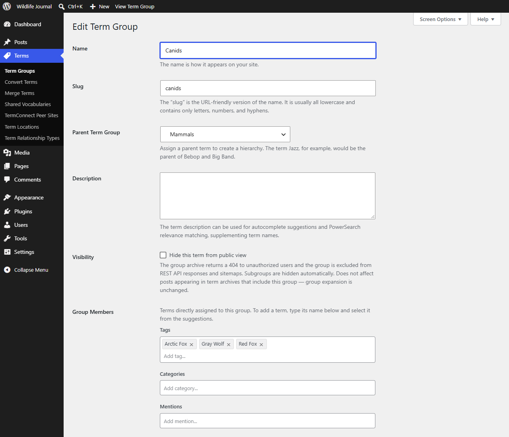

# Term Groups
{: .no_toc }

Term Groups collect terms from any enabled taxonomy into named, hierarchical sets. A term can belong to any number of groups, and each group has its own archive. Groups also act as building blocks for term archives: a term can include a whole group, or use a group as its container (see [Group Inclusions](term-relationships.html#group-inclusions) and [Container Groups](term-relationships.html#container-groups)). For when to use groups rather than other features, see [Concepts](concepts.html#term-groups).

## Table of contents
{: .no_toc .text-delta }

1. TOC
{:toc}

---

## Creating groups

1. Go to **Terms > Term Groups**
2. Create and organize groups like categories — they support parent/child hierarchy

## Assigning terms to groups

- **Term edit screen** — Use the **Term Groups** checklist to assign the term to one or more groups. It sits directly above the [Term Relationships](term-relationships.html) section.
- **Quick Edit** — Click Quick Edit on any term row to update group assignments inline via a scrollable checklist, without leaving the list.
- **Bulk actions** — Select multiple terms and choose **Assign to Term Groups…** to open a group selector modal. The checklist uses three states (Gmail-style): a filled dash `−` means the group is currently assigned to *some but not all* selected terms (no change on save); `✓` means add this group to all selected terms; `☐` means remove this group from all selected terms. Click a checkbox to cycle through the states. The **Apply** button activates only when at least one group has been changed from its initial state. Existing group memberships not mentioned in the modal are always preserved.

## Group archives

Each group has an archive page at its own URL, showing posts from all member terms across all enabled taxonomies.

A group's count, as WordPress stores it, is the number of terms directly in the group, not counting its subgroups' members, the same way a category's count leaves out its subcategories' posts. Counts update whenever terms join or leave a group, and are recounted when the plugin is activated.

The XML sitemap lists a group only when its archive shows published posts, counting its subgroups' members as the archive does. A group whose members have no posts yet is left out until they do.

## Managing group members from the group side

The Term Groups admin screen (**Terms > Term Groups**, then click a group to edit) shows the following fields:

- **Group Members** — terms directly assigned to this group, organized by taxonomy (Tags, Categories, custom taxonomies). Add or remove members here without editing each term individually.
- **Container For** — terms for which this group acts as a container group. Their posts appear in the archives of all group members belonging to the same taxonomy. Adding a term here is equivalent to setting this group as that term's container group on its own edit screen.
- **Included By** — terms whose archives include all posts from members of this group (same taxonomy). Adding a term here adds this group to that term's included groups.
- **Term Icon** — upload a custom icon for the group, used in group archive headings and shortcodes (requires *Enable Term Group icons* in **Settings > HyperTaxonomy > Features > Term Groups**).
- **Visibility** — check **Hide this term from public view** to hide this group (requires *Enable Term Group visibility options* in **Settings > HyperTaxonomy > Features > Term Groups**). See [Group visibility](#group-visibility) below.
- **Show Description** — checkbox to show the group's description below the archive heading.

When you follow a group link from a term pill tooltip, the group edit page highlights the relevant pill and, for indirect associations, shows a context panel just above the **Group Members** section. If the association is direct (the term is an immediate member, or directly included/including), a blue border is drawn around the relevant pill in the **Group Members**, **Container For**, or **Included By** field — no extra notice is needed since the relationship is already visible there. If the association is indirect (the term is in a subgroup, a parent group, or a related ancestor group), the context panel names each intermediate group as a clickable link so you can navigate directly to where the relationship is defined.

## Group visibility

When *Enable Term Group visibility options* is turned on in **Settings > HyperTaxonomy > Features > Term Groups**, a **Visibility** checkbox appears on each group's edit screen. Hiding a group:

- Returns a **404** to unauthorized users who visit the group's archive URL directly.
- **Excludes** the group from WordPress REST API group listings and XML sitemaps.
- **Cascades automatically** to all child groups — subgroups are hidden without requiring individual edits. When you make a parent visible, its children stay hidden unless you confirm making them visible too. A child can't be made visible while its parent is hidden.
- **Does not affect archive expansion.** Posts continue to appear in term archives that include or use the group for expansion. Group membership behavior is shared across all users; only the group's own archive page is gated.

**Settings > HyperTaxonomy > Display > Hidden Terms** controls who can see hidden group archives: no one, users who can edit posts, or everyone.

## Displaying groups

The [`[ht_term_groups]`](term-lists.html#ht_term_groups) shortcode and its block list groups with their member terms. The other term list and cloud shortcodes take `include_groups` and `exclude_groups` attributes to show or leave out a group's members. See [Term Lists & Clouds](term-lists.html).
