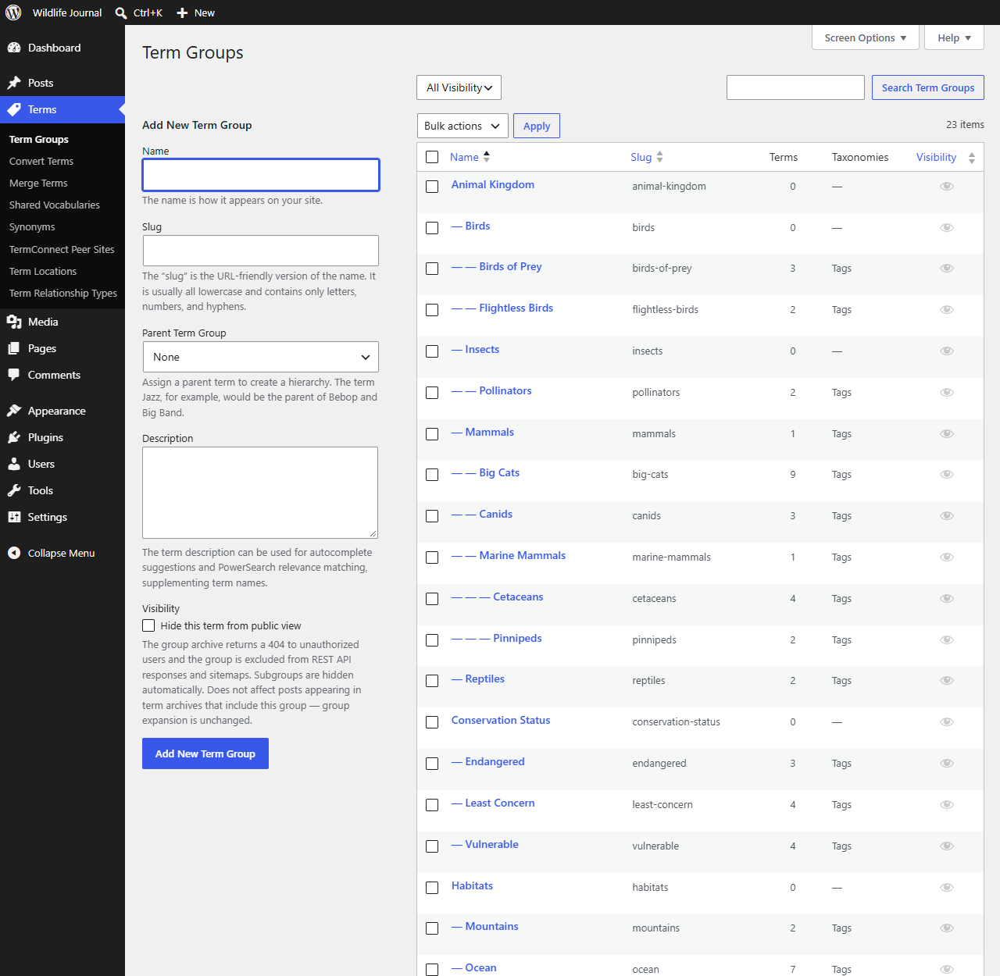
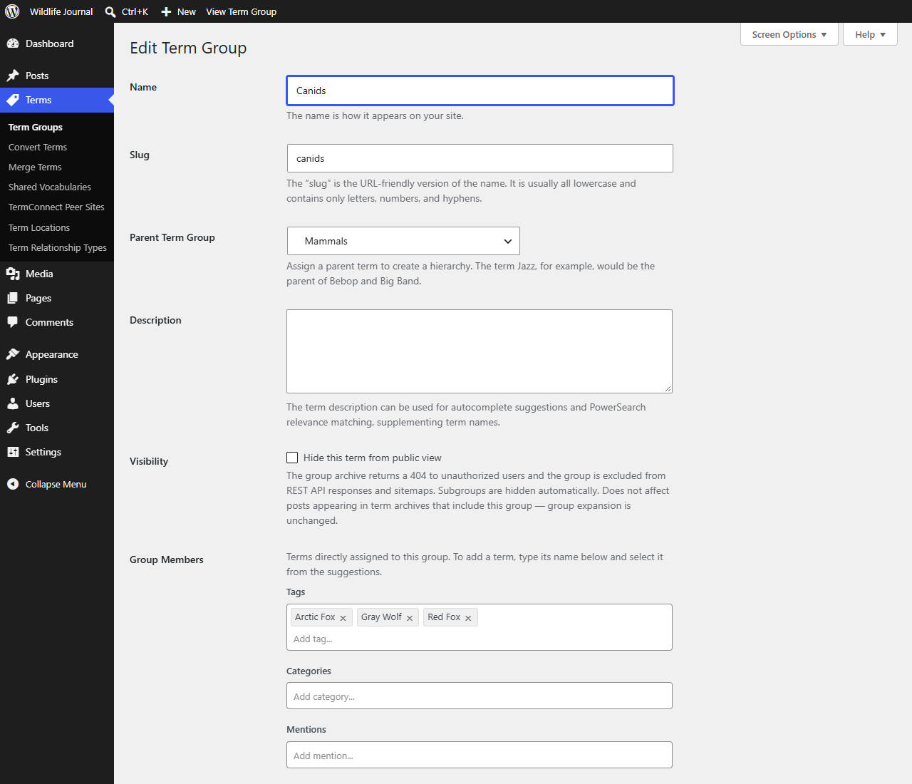

# Term Groups
{: .no_toc }

Term Groups collect terms from any enabled taxonomy into named, hierarchical sets. A term can belong to any number of groups, and each group has its own archive. Groups also act as building blocks for term archives: a term can include a whole group, or use a group as its container (see [Group Inclusions](term-relationships.html#group-inclusions) and [Container Groups](term-relationships.html#container-groups)). For when to use groups rather than other features, see [Concepts&nbsp;→ Which to Use When](concepts.html#which-to-use-when).

## Table of contents
{: .no_toc .text-delta }

1. TOC
{:toc}

---

## Creating groups

1. Go to **Terms&nbsp;→ Term Groups**
2. Create and organize groups like categories — they support parent/child hierarchy

The **Term Groups** screen works like the Categories screen. The form on the left adds a group: its **Name**, an optional **Slug**, a **Parent Term Group** to make it a subgroup, a **Description**, and the **Visibility** checkbox (see [Group visibility](#group-visibility)). Terms join a group from their own edit screen, or in bulk from the term list (see [Editing a group](#editing-a-group)).

The list on the right shows the groups as a hierarchy, each subgroup indented under its parent. Besides each group's **Name** and **Slug**, it shows:

- **Terms** — how many terms are directly in the group. Members of its subgroups aren't counted, so a parent group that only holds subgroups shows 0 (see [Group archives](#group-archives)).
- **Taxonomies** — the taxonomies of the group's own members, such as Tags or Categories; **—** when it has none.
- **Visibility** — a faded eye icon () for a visible group (the default), crossed out () for a hidden group. Click the column header to list hidden groups first.

The **All Visibility** filter above the list shows only visible or only hidden groups, and the search box finds groups by name. Hover over a group for the usual **Edit**, **Quick Edit**, **Delete** and **View** links.

## Group archives

Each group has an archive page at its own URL, showing posts from all member terms across all enabled taxonomies.

A group's count, as WordPress stores it, is the number of terms directly in the group, not counting its subgroups' members, the same way a category's count leaves out its subcategories' posts. Counts update whenever terms join or leave a group, and are recounted when the plugin is activated.

The XML sitemap lists a group only when its archive shows published posts, counting its subgroups' members as the archive does. A group whose members have no posts yet is left out until they do.

## Editing a group

Go to **Terms&nbsp;→ Term Groups** and click a group to edit it. Besides its name, slug, parent group and description, the group's edit screen lets you:

- choose its members, in **Group Members**;
- set the terms it acts as a container group for, in **Container For**;
- set the terms that include it, in **Included By**;
- give it an icon, hide it, and show its description on its archive.

The first three can also be set from each term's own edit screen; each section below says where.

When you follow a group link from a term pill tooltip, the group edit page highlights the relevant pill and, for indirect associations, shows a context panel just above the **Group Members** section. If the association is direct (the term is an immediate member, or directly included/including), a blue border is drawn around the relevant pill in the **Group Members**, **Container For**, or **Included By** field — no extra notice is needed since the relationship is already visible there. If the association is indirect (the term is in a subgroup, a parent group, or a related ancestor group), the context panel names each intermediate group as a clickable link so you can navigate directly to where the relationship is defined.

### Group Members

The terms directly assigned to this group, organized by taxonomy (Tags, Categories, custom taxonomies). Add or remove members here without editing each term. A term in a subgroup counts as a member of this group too, without being listed here.

You can also assign a term to groups from the term itself: on its edit screen, in Quick Edit, or with a bulk action on the term list. See [Per-Term Settings&nbsp;→ Group Membership](per-term-settings.html#group-membership).

### Container For

The terms for which this group is a [container group](term-relationships.html#container-groups): their posts appear in the archives of the members of this group and of its parent groups, in the same taxonomy (reverse inclusion). Adding a term here is the same as adding this group to the **Container** field on the term's own edit screen.

### Included By

The terms whose archives [include this group](term-relationships.html#group-inclusions): they show posts from all of the group's members, including members of its subgroups, in their own taxonomy. Adding a term here is the same as adding this group to the **Included** field on the term's own edit screen.

In both **Container For** and **Included By**, a member that is the term itself, or its ancestor or descendant in a hierarchical taxonomy, is disregarded.

Each of these three fields lists only taxonomies where the matching feature is on: **Group Assignment** for **Group Members**, **Term Relationships** for **Container For** and **Included By** (see [Plugin Settings&nbsp;→ Features Tab](plugin-settings.html#features-tab)). Saving the group keeps its memberships and relationships with terms of other taxonomies, though the fields don't show them.

### Term Icon

Upload a custom icon for the group, used in group archive headings and shortcodes. This needs *Enable Term Group icons* in **[Settings&nbsp;→ HyperTaxonomy&nbsp;→ Features](plugin-settings.html#features-tab)&nbsp;→ Term Groups**. Icons work as they do for other terms; see [Per-Term Settings&nbsp;→ Term Icons](per-term-settings.html#term-icons).

### Group visibility

When *Enable Term Group visibility options* is turned on in **[Settings&nbsp;→ HyperTaxonomy&nbsp;→ Features](plugin-settings.html#features-tab)&nbsp;→ Term Groups**, the group's edit screen has a **Visibility** row: check **Hide this term from public view** to hide the group. Hiding a group:

- Returns a **404** to unauthorized users who visit the group's archive URL directly.
- **Excludes** the group from WordPress REST API group listings and XML sitemaps.
- **Cascades automatically** to all child groups — subgroups are hidden without requiring individual edits. When you make a parent visible, its children stay hidden unless you confirm making them visible too. A child can't be made visible while its parent is hidden.
- **Does not affect archive expansion.** Posts continue to appear in term archives that include or use the group for expansion. Group membership behavior is shared across all users; only the group's own archive page is gated.

**Settings&nbsp;→ HyperTaxonomy&nbsp;→ Display&nbsp;→ Hidden Terms** controls who can see hidden group archives: no one, users who can edit posts, or everyone.

### Show Description

Check **Show Description** to show the group's description below its archive heading, as for other terms (see [Per-Term Settings&nbsp;→ Archive Descriptions](per-term-settings.html#archive-descriptions)). The checkbox appears when *Archive customization* is turned on in **[Settings&nbsp;→ HyperTaxonomy&nbsp;→ Features](plugin-settings.html#features-tab)&nbsp;→ Term Groups**; it's off by default.

## Displaying groups

The [`[ht_term_groups]`](term-lists.html#ht_term_groups) shortcode and its block list groups with their member terms. The other term list and cloud shortcodes take `include_groups` and `exclude_groups` attributes to show or leave out a group's members. See [Term Lists & Clouds](term-lists.html).
