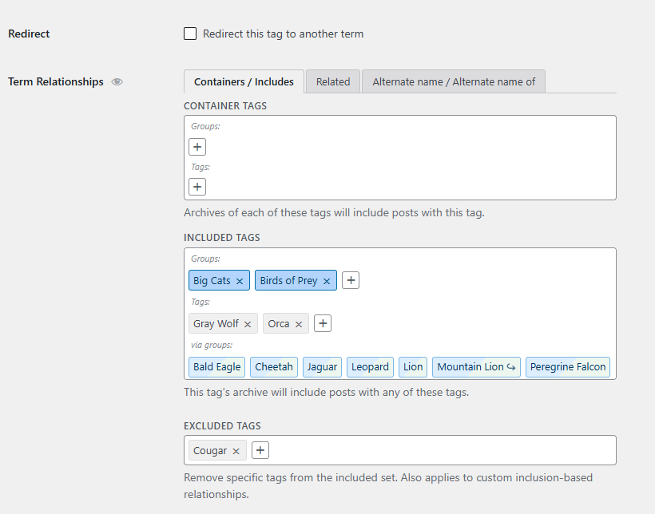
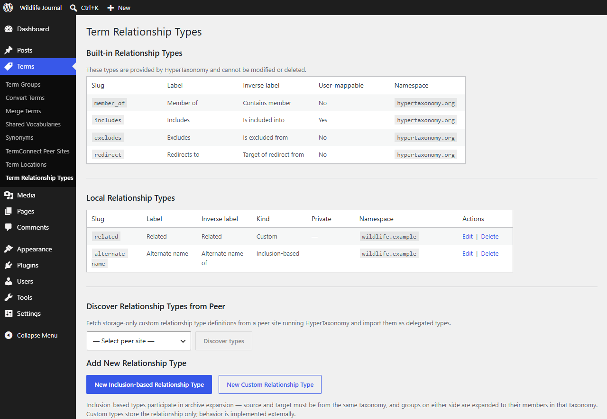

# Term Relationships
{: .no_toc }

Relationships are set on the term edit screen: edit any tag, category, or custom taxonomy term and use its **Term Relationships** section. A group's relationships can also be set from the group's own edit screen (see [Term Groups](term-groups.html#editing-a-group)), and the [Synonyms page](#the-synonyms-page) lists the synonyms that result from them.

Creating Term Groups, assigning terms to them and managing them from the group's own screen are covered in [Term Groups](term-groups.html). This page covers how groups take part in relationships: [Group Inclusions](#group-inclusions) and [Container Groups](#container-groups). Both need **Group Assignment** enabled for the taxonomy in [Settings&nbsp;→ HyperTaxonomy&nbsp;→ Features](plugin-settings.html#features-tab); while it is off, they are ignored.

Each built-in relationship type, as well as the custom types that you can define, is explained in its own section below, followed by the general [Term Relationships Display](#the-term-relationships-display) section, which explains the colors, symbols, badges and controls you see on the term edit screen.

## Table of contents
{: .no_toc .text-delta }

1. TOC
{:toc}

---

## Inclusions and Containers

An inclusion is one relationship that you can set up from either of the two terms. When term A **includes** term B, posts assigned to B appear in A's archive. Seen from B, A is a **container**: B's posts appear in A's archive. Adding B to A's **Included** field or adding A to B's **Container** field results in the same relationship, and each term's edit screen shows it in the corresponding field.



**To add an inclusion:** Depending on the perspective that your workflow reflects, use the **Included** or **Container** autocomplete field, which is named for the taxonomy (for example, **Included Tags** or **Container Tags**):
- "What terms should appear in my archive?"&nbsp;→ use the **Included** field
- "Which archives should my posts appear in?"&nbsp;→ use the **Container** field

Type to search, select a term, save.

**Constraints:**
- Inclusions must be explicit. If A includes B and B includes C, it does not imply that A includes C.
- Self-inclusions are not permitted.
- Terms from different taxonomies cannot directly include each other (cross-taxonomy is only supported for redirects and group memberships, discussed below).
- Terms from hierarchical taxonomies cannot include their own ancestors or descendants. Descendants' posts already appear through the WordPress native hierarchy, and including an ancestor would result in an infinite loop.

## Group Inclusions

Instead of including individual terms one by one, you can include an entire Term Group. All current and future members of that group, whose taxonomy matches the container term's taxonomy, are automatically included — no manual maintenance as the group grows.

**To add a group inclusion:** Search for the group in the **Included** field on the term edit screen, which accepts both terms and groups. Alternatively, you can set it up from the group: add the term to the group's [**Included By**](term-groups.html#included-by) field.

**Seen from each member:** the including term becomes a container for every member of the group in its own taxonomy, and appears, read-only, in each member's **Container** field. While the group may contain a member that is the including term itself, or its ancestor or descendant in a hierarchical taxonomy, such terms are automatically disregarded for inclusion purposes.

**Example:** "Emergency Conditions" includes group "Chest Pain Causes". When a new condition is added to that group, it automatically appears in Emergency Conditions archives.

Groups are hierarchical: including a parent group includes all terms from that group and all its descendant groups.

## Container Groups

If a term specifies a Term Group as its **container**, that term's posts will appear in the archives of each member of that group that belongs to the same taxonomy. Members of a container group's parent groups get the posts too. This is also known as reverse inclusion.

**To add a container group:** Search for the group in the **Container** field on the term edit screen, which accepts both terms and groups. Alternatively, you can set it up from the group: add the term to the group's [**Container For**](term-groups.html#container-for) field.

**Seen from each member:** every member of the group in the term's taxonomy includes the term, which appears, read-only, in each member's **Included** field. As with group inclusions, a member that is the term itself, or its ancestor or descendant in a hierarchical taxonomy, is automatically disregarded for reverse inclusion purposes.

**Not the same as a group inclusion.** The two are stored separately and point in opposite directions. A group inclusion brings every member's posts into one term's archive; a container group puts one term's posts into every member's archive.

**Example:** "Pneumonia" has container groups "Chest Pain Causes" and "Fever Causes". The archive of every term in those groups shows Pneumonia posts.

Container groups appear as green pills, and the terms reached through them appear in light green. Those terms can't be removed individually: remove the container group, or change the group's members.

## Synonyms

When two terms include each other, they become synonyms: each term's archive shows the posts assigned to the other.

**On the term edit screen**, the [⇆&nbsp;symbol](#symbols) marks synonyms in the term's own relationship fields: a pill in the **Included** field whose term is also in the **Container** field, and a pill in the **Container** field whose term this term also includes, directly or through an included group. A pill that redirects isn't marked. These marks only reflect the relationships shown on this screen; [The Synonyms page](#the-synonyms-page) lists every pair, however the two terms became synonyms.

**How terms become synonyms.** Each of the two inclusions can come about in any of the ways a term includes another, and the two directions don't have to match:
- **Direct inclusion** — Term A has Term B in its **Included** field (and Term B has Term A in its **Container** field).
- **[Group inclusion](#group-inclusions)** — Term A includes a group that Term B belongs to, or a parent group of one. For example, two terms that are both members of a group, and both include that group, are synonyms.
- **[Container group](#container-groups)** — Term B has a container group that Term A belongs to, or a container group whose parent group Term A belongs to. For example, two terms that are both members of a group, and both have that group as their container group, are synonyms.
- **[Custom relationship types](#custom-relationship-types)** — an inclusion-based custom type counts the same as a built-in inclusion, whether set directly or through a group.

When Term B also includes Term A in one (or more) of the ways listed above, the two form a synonym pair. For example, Term A may include Term B directly, while Term B includes Term A through a group. Synonyms follow what each term actually includes, so an [exclusion](#exclusions) undoes them: if Term A excludes Term B, the two aren't synonyms, even if each would otherwise include the other. A term that [redirects](#redirects) has no inclusions in effect, and therefore no synonyms.

**Synonyms share posts, not relationships.** Like synonyms in natural language, synonym terms are rarely interchangeable in every context: their meanings mostly overlap, but may differ in subtle ways. In HyperTaxonomy, each synonym's archive shows the posts directly assigned to the other term. They don't share relationships, though: if one synonym includes other terms and the other doesn't, the first synonym's archive also shows posts from its own inclusions, which the second synonym's archive doesn't. This follows from inclusions being non-transitive: when A includes B and B includes C, A doesn't include C.

**Example:** "Automobile" and "Car" include each other, and "Automobile" also includes "Truck". The Automobile archive shows posts assigned to Automobile, Car and Truck. The Car archive shows posts assigned to Car and Automobile, but not Truck posts, unless Car also includes Truck. To make two synonyms' archives the same, give both terms the same inclusions; if the two terms mean the same thing in every context, consider [merging](merge-convert.html#merge-terms) them instead.

Mutual inclusion (A includes B, B includes A) is explicitly supported and useful. It differs from circular redirects, which are prevented, and from including an ancestor in a hierarchy, which is disregarded.

### The Synonyms page

Sometimes synonyms are set up deliberately, to let editors use whichever of two interchangeable terms fits the context best, but often they result from indirect relationships crossing paths, for example overlapping group inclusions. **Terms&nbsp;→ Synonyms** detects and lists every pair of synonyms in the taxonomies where **Term Relationships** is enabled, no matter how they became synonyms. Each pair is listed twice (term A and its synonym B, then B and its synonym A, possibly among other synonyms of the same terms), with these columns:
- **Term** and **Synonym** — each linked to its edit screen, with its post count, and marked **Hidden** if it is [hidden](per-term-settings.html#term-visibility).
- **Taxonomy** — the taxonomy of the two terms.
- **Inclusion paths** — every way the row's term includes its synonym, one per line: **→&nbsp;direct** (an inclusion set on the term itself, or on the synonym as a container), **⇢&nbsp;“Type”** (directly, by a custom inclusion-based relationship type), **⇒&nbsp;Group › Subgroup** (group inclusion: the term includes the first group, and the synonym belongs to the last, a subgroup of it), or **⇐&nbsp;Subgroup ‹ Group** (container group: the synonym's container group comes first, and the term belongs to the last, a parent group of it). A custom type's name follows group paths in parentheses. Hover over a line for the full wording. **⇄&nbsp;reverse** jumps to the row with the same two terms in the other order, which shows the other direction, on whichever page it falls. When one of the two terms includes terms that the other doesn't, so that their archives show different posts, an **Archives differ** note below the paths names those terms (the first few, then how many more).


In this example, the Marine Life tag includes the Marine Mammals group, whose subgroups are Cetaceans and Pinnipeds, and Marine Life's container group is Cetaceans. Reading the rows:
- **Killer Whale and Orca** include each other directly, so their rows show **→&nbsp;direct**. Orca also includes Killer Whale by a custom inclusion-based type, **Alternate name**, which adds a **⇢&nbsp;“Alternate name”** line and a link to that tab of Orca's edit screen.
- **Marine Life includes Orca** through the group it includes: **⇒&nbsp;Marine Mammals › Cetaceans** says that Marine Life includes Marine Mammals, and Orca is a member of its Cetaceans subgroup.
- **Orca includes Marine Life** the other way round: **⇐&nbsp;Cetaceans** says that Marine Life has Cetaceans as a container group, and Orca is a member of it. The ✎&nbsp;links lead to Marine Life's **container terms** and Orca's **term groups**.
- **Marine Life includes Walrus** in two ways, each on its own line: Walrus is a member of Marine Mammals itself, and of its Pinnipeds subgroup.
- **Walrus includes Marine Life** through **⇐&nbsp;Cetaceans ‹ Marine Mammals**: Marine Life's container group is Cetaceans, and Walrus belongs to Marine Mammals, the parent group of Cetaceans. A container group applies to the members of its parent groups too.
- Marine Life includes the whole Marine Mammals group, while the other tags don't, so every row pairing Marine Life with another tag lists the tags that only Marine Life includes, after **Archives differ**.

Above the table, you can filter the list:
- **Taxonomy** — a pair of synonyms can only exist within the same taxonomy.
- **Inclusion type** — **Direct inclusion**, **Group inclusion** or **Container group**: pairs in which either term includes the other in that way, so a pair whose two directions differ (say, one direct and one through a group) matches both.
- **Relationship type** — **Includes** or an inclusion-based custom type, shown when such custom types exist. Combined with the previous filter, both must match the same way of inclusion.
- **Archives differ** — pairs in which one term includes terms that the other doesn't, so their archives show different posts.
- A search box, which matches the names of both terms.

The list is sorted by the **Term** column, A to Z or Z to A; ties are sorted by the synonym's name. **Screen Options** sets how many rows appear per page.

The **Actions** column lists, for each row: **⧉&nbsp;Merge** into the synonym (for users who can access [Merge Terms](merge-convert.html#merge-terms)), and **✎** links to the parts of the two terms' edit screens that hold the relationship — the term's **included terms**, the synonym's **container terms**, a custom type's tab, or either term's **term groups** for a group path. Each opens the edit screen at that section, switching tab or expanding **More options** as needed. **Merge** opens the Merge Terms page with the taxonomy, the source term (the row's term) and the target term (its synonym) already filled in. Nothing is merged until you confirm there.

## Exclusions

Exclusions remove specific terms from the included set without affecting native WordPress parent/child relationships.

**Processing order (applied to term archives):**

All inclusions are gathered first, then all exclusions are applied. Exclusions always win — no inclusion source can override them.

| Phase | Step | Action |
|-------|------|--------|
| Inclusions | 1 | Expand all included groups to member terms (with descendant subgroup expansion) |
| | 2 | Add directly included terms |
| | 3 | Add terms via container groups — this term's member groups (expanded to subgroups) matched against container group relationships |
| Exclusions | 4 | Remove directly excluded terms |
| | 5 | Remove self (in all cases) + ancestors and descendants (hierarchical taxonomies only — prevents overlap with native WP hierarchy and infinite loops) |

**Example:**
```
"Modern Web Dev" includes Group "JS Frameworks" + Group "CSS Tools" + Term "TypeScript"
"Modern Web Dev" excludes Term "CoffeeScript"

Result: All JS Frameworks + CSS Tools terms + TypeScript, minus CoffeeScript
```

Exclusions never affect native WordPress parent/child hierarchy. A child category always appears in its parent's archive, regardless of any exclusion settings.

**Effect on the Includes panel:** When a term appears in both the includes panel and the excludes panel, the admin interface signals the conflict:

- **Direct includes** that are also excluded are shown with <s>strikethrough</s> text and reduced opacity. The ×&nbsp;button remains active so the redundant direct include can be removed. The exclusion wins at runtime regardless.
- **Indirect includes** (added via groups) that are excluded are suppressed entirely from the includes panel — they are not in the archive and showing them would be misleading. The group pill itself is unaffected; removing the exclusion restores the indirect inclusion pill.

**To add an exclusion:** Use the **Excluded** field on the term edit screen, which is named for the taxonomy (for example, **Excluded Tags**).

{: .note-title }
> Display shortcodes
>
> The [term list shortcodes](term-lists.html) (`[ht_term_list]`, `[ht_term_cloud]`, `[ht_term_groups]`, and `[ht_term_index]`) have their own `exclude_groups` attribute that removes group members from the displayed term list. This is a shortcode display filter, separate from the term archive processing described above.

## Redirects

Set a 301 redirect from this term to another term. Visitors going to this term's archive URL are redirected to the target term's archive.

**Behavior:**
- `/tag/old-name/` →&nbsp;301 redirect&nbsp;→ `/tag/new-name/`
- Posts tagged with "old-name" appear in the target's archive only if the target includes "old-name", like any other included term; the redirect doesn't do that by itself. [Searches](search-overview.html) for the target find them either way, unless **Redirects** is turned off under [Term Relationship Expansion](plugin-settings.html#search-tab)
- This term has no accessible archive of its own
- Redirect terms are shown in *italics* in shortcodes and term lists by default
- Redirecting to a term from a different taxonomy is permitted

**Redirect chain resolution:** If Tag A redirects to Tag B, and you later set Tag B to redirect to Tag C, Tag A automatically updates to redirect directly to Tag C. No chains are stored.

**Circular redirect resolution:** If A→B exists and you set B→A, the plugin automatically resolves this by removing A→B and setting B→A (flipping direction), updating any other terms that pointed to B.

**Mutual inclusion vs. circular redirects:**
- Mutual inclusion (A includes B, B includes A) = valid synonyms
- Circular redirects (A→B→A) and self-redirects (A→A) = invalid, automatically resolved or prevented

**To set a redirect:** On the term edit screen, check **Redirect this tag to another term** (named for the taxonomy), choose the target taxonomy, then choose the target term.

**Relationships while redirecting:** All relationships set on a redirect term — inclusions, exclusions, sticky posts, custom relationship types (and [external links](https://hypertaxonomy.org/termconnect/user-guide/concepts.html#term-equivalence-and-external-identifiers), when TermConnect is active) — are preserved in the database, but have no effect on archives, search results, or `[ht_post_list]` while the redirect is active. The redirect term has no accessible archive of its own, so there is nothing to expand into. The inclusions section is not shown in the term edit screen while a redirect is active; it reappears when the redirect is removed.

For hierarchical taxonomies (categories and hierarchical custom taxonomies), posts assigned to descendants of a redirect term are also suspended from matching searches for that term or any of its ancestors, because the path runs through the redirect. This, too, is restored automatically when the redirect is removed.

## Custom Relationship Types

Beyond the built-in relationships above, you can define your own. All types, built-in and your own, are listed at **Terms&nbsp;→ Term Relationship Types**.



The page has these parts, top to bottom:
- **Built-in Relationship Types** — the four core types (member_of, includes, excludes, redirect), with each one's **Label** and **Inverse label**, the wording used for the two directions of a relationship. **User-mappable** marks the type that your own inclusion-based types work like: Includes. **Namespace** identifies who defined a type, so that sites sharing types can tell them apart; the built-in types use HyperTaxonomy's.
- **Local Relationship Types** — the types defined on this site, with an **Edit** and **Delete** link for each. **Kind** is **Inclusion-based** or **Custom** (storage-only; see below). **Private** marks a type left out of what peer sites can see. **Namespace** is this site's.
- **Remote Relationship Types** — shown only when [TermConnect](https://hypertaxonomy.org/termconnect/) has synced types from peer sites. They are read-only, and **Make local** detaches one from its source.
- **Discover Relationship Types from Peer** — with TermConnect, fetches the storage-only types a peer site has defined, to import them as delegated types.
- **Add New Relationship Type** — a button for each kind of type, described below.

**Creating a new type.** Two buttons are shown at the bottom of the page, one for each kind of type.

### Inclusion-based types

**New Inclusion-based Relationship Type** creates a type that participates in archive expansion exactly like the built-in Includes type. Source and target must be terms from the same single taxonomy you select when creating the type, or they can be groups. However, groups on either side are expanded to their members in that taxonomy; group members from other taxonomies are ignored. Inclusion of hierarchy ancestors or descendants, as well as self-inclusion via groups, is disregarded; direct self-inclusion is prevented. The type and its source or target taxonomy cannot be changed after its initial creation.

### Storage-only types

**New Custom Relationship Type** creates a type that stores the relationship only. HyperTaxonomy provides the infrastructure (term edit UI, storage, API), while behavior should be implemented externally by your theme or plugin. No automatic archive expansion occurs. Source and target taxonomies are independent and optional.

**Symmetric relationships.** Checking **Symmetric** when creating a storage-only type means the relationship has no distinct direction — "A is Related to B" and "B is Related to A" are the same thing. For symmetric types:

- The term edit screen shows a **single unified list** instead of separate forward and reverse sections.
- Each pill shows a small direction arrow: **→** means this term added the link (from this page); **←** means the other term added it (managed from that term's edit page). You can remove links from either direction without leaving the current page.
- HyperTaxonomy prevents duplicates automatically. A term already linked in either direction will not appear in the autocomplete suggestions. Imports and code that uses the PHP API skip a pair that is already stored in the other direction, too.

### Rules for all custom types

Inclusion-based Custom Relationship Type cannot be converted to Storage-only Custom Relationship Type after its creation, and vice versa. The slug is also locked after first save and cannot be edited.

**Label uniqueness.** Every type — built-in and custom — must have a unique label and inverse label. The labels and inverse labels of the four built-in types are: *Includes* / *Is included into*, *Excludes* / *Is excluded from*, *Redirects to* / *Target of redirect from*, and *Member of* / *Contains member*. Attempting to save a custom type whose label or inverse label matches any of these (or any other existing custom type's labels) will produce a validation error. However, for symmetric storage-only custom relationship types, their labels and inverse labels are identical.

**Groups and custom types.** Term Groups can be used on either side of inclusion-based custom relationships, just like the built-in Includes type. Storage-only custom types do not support groups, because group expansion is tied to archive query behavior, which storage-only types do not implement.

## The Term Relationships Display

The term edit screen shows all relationship fields in the **Term Relationships** section (labeled in the left column of the edit form, immediately below **Term Groups**). This part explains how to read that section.

### Panel order

The built-in panels appear in this order: **Container Tags**&nbsp;→ **Included Tags**&nbsp;→ **Excluded Tags**. For custom relationship types, the reverse direction (what points *to* this term) comes first, then the forward direction. This order puts the "what uses this term" perspective at the top consistently.

### Color coding

*Term Groups panel (groups this term belongs to):*

| Color | Meaning |
|-------|---------|
| White | Groups this term is assigned to (removable) |

*Includes panel — removable pills:*

| Color | Meaning |
|-------|---------|
| Blue | Included groups |
| Gray | Directly included terms |
| Light-blue/gray gradient | Direct terms that are also members of included groups |
| Light-green/gray gradient | Direct terms that are also pulled in via container groups |
| Light-blue/light-green gradient | Direct terms that are also reachable via both group paths |

*Includes panel — non-removable pills (indirect):*

| Color | Meaning |
|-------|---------|
| Light-blue | Terms included as members of an included group (forward path) |
| Light-green | Terms included via container group relationship (reverse path) |
| Light-blue/light-green | Terms reachable via both indirect paths simultaneously |
| Tan | Terms included via an inclusion-based custom relationship type (no group path) |
| Other + tan tooltip | Terms reachable via a group path AND a custom type; tan is shown in the tooltip only |

*Containers panel — removable pills:*

| Color | Meaning |
|-------|---------|
| Gray | Direct container terms |
| Green | Container groups |
| Light-green/gray gradient | Direct containers also in this term's container groups |
| Light-blue/gray gradient | Direct containers that also include a group this term is a member of |
| Light-blue/light-green gradient | Direct containers that are also reachable via both group paths |

*Containers panel — non-removable pills (indirect):*

| Color | Meaning |
|-------|---------|
| Light-green | Terms in this term's container groups (forward path) |
| Light-blue | Terms that include a group this term is a member of (reverse path) |
| Light-blue/light-green | Terms reachable via both indirect paths simultaneously |
| Tan | Terms whose archives include this term via an inclusion-based custom relationship type (no group path) |
| Other + tan tooltip | Reachable via a group path AND a custom type; custom type shown in tooltip only |

To hide the non-removable (indirect) pills, click the eye icon () next to the **Term Relationships** label; the group pills stay visible as a summary. Your choice applies to every term you edit, and is saved with your user account, so it stays the same across browsers and devices. Each user has their own setting.

### Symbols

| Symbol | Meaning |
|--------|---------|
| ⇆ | Synonym — this pill's term also includes the current term |
| ↩ | Redirects here — this pill's term redirects to the current term (informational) |
| ↪ | Redirects elsewhere — this pill's term has no standalone archive; dimmed on containers (relationship inactive), informational on includes |
| <s>Strikethrough</s> | Included but overridden by an exclusion rule — has no effect at runtime |

### Tooltip path indicators

Shown on hover for pills reached through more than one path, or only indirectly:

| Indicator | Meaning |
|-----------|---------|
| `⇒ via: GroupName` | Included as a member of the named group (forward group path) — click the name to open that group |
| `⇐ via: GroupName` | Pulled in via a container group relationship (reverse group path) — click the name to open that group |
| `⇢ Type Label` | Included via the named inclusion-based custom relationship type (forward direction) — click to switch to that relationship's tab |
| `⇠ Type Label` | This term's archive is included via the named custom type from the pill's term (reverse direction) — click to switch to that relationship's tab |

Group name links open that group's edit page with context. `⇒ via:` links follow a membership path (the pill's term is a member of the linked group or one of its subgroups); `⇐ via:` links follow an includes path (the linked group includes the pill's term, or the pill's term includes the linked group). On the group edit page, if the association is direct, the relevant pill is highlighted with a blue border. If it is indirect — the term is in a subgroup, a parent group, or an ancestor group — a context panel just above **Group Members** names each intermediate group as a further link, so you can navigate to where the relationship is defined.

### Path count badge

Direct includes (editable, with ×&nbsp;button) are listed first, sorted A–Z. Indirect includes (via groups, read-only) follow under a **via groups:** label, also sorted A–Z.

When a term is reachable via more than one path (directly included, via one or more included groups, and/or via container groups), a small **N** badge (white circle) appears on its pill. Hover anywhere on the pill to see a tooltip listing the exact paths:

- **⇒&nbsp;via: Group A, Group B** — groups through which this term is included (from the groups in the **Included** field)
- **⇐&nbsp;via: Group C** — groups through which a reverse container-group path brings this term in

A term with no badge has exactly one path. Remove or change group memberships to reduce path count.

### Hiding indirect and reverse relationships

When a term belongs to large groups, the non-removable indirect pills can become unwieldy. A **Hide indirect and reverse relationships** button (the eye icon, ) appears next to the **Term Relationships** label whenever the term has indirect pills. It applies across all relationship tabs:

- **Off (default):** all indirect pills are shown individually.
- **On:** individual indirect pills are hidden. Group pills stay visible, so it's still clear which groups are the source, without listing every member term.

The state is saved per-term, so terms with large groups can be collapsed, while others stay expanded. The preference persists across page loads in the browser (stored locally; not tied to your account).
