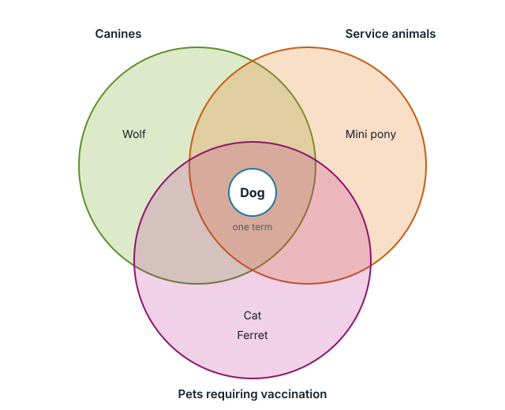

# Why HyperTaxonomy

WordPress organizes content with taxonomies, and offers two kinds: flat ones like tags, and trees like categories. Both make you choose where a term belongs, and both lose content when a term belongs in more than one place. This page shows the problem with one example, and how HyperTaxonomy solves it.

## Tags have no structure

Tags don't know about each other. A post tagged *Dog* doesn't appear in the *Canines* archive, even though every dog is a canine. To get it there, every dog post has to be tagged *Canines* too, by hand, and every editor has to remember to do it. Archives drift out of step with each other as soon as someone forgets.

## A tree answers one question

A category tree fixes that for one structure. Sort animals by descent, and *Dog* sits under *Canines*, under *Mammals*: a post filed under *Dog* appears in all three archives. The tree works because every level answers the same question: what is this animal descended from?

But a dog is also a service animal, a role it shares with miniature ponies. And a pet shop sells dogs alongside cats and guinea pigs. Those are different questions, *what work does it do?* and *what can I buy?*, and their answers don't fit the descent tree. Mixing them into it would break it: a miniature pony isn't a canine.

So each question needs its own tree. But a category has only one parent, so *Dog* can sit in only one of them. Every other tree gets its own duplicate *Dog*:

The duplicates aren't connected. A post about guide dogs filed under the service-animal *Dog* never appears in the *Canines* archive, and a post filed under the descent tree's *Dog* never appears among service animals. To show a post everywhere it belongs, an editor has to file it under every copy, which is the tag problem again.

Custom taxonomies don't help. Each one is either flat or a tree, with the same limits.

## One term, many structures

HyperTaxonomy lets a term belong to as many structures as it needs, without copies. Keep the descent tree as it is. Add *Service animals* and *Pets for sale* as categories in the same taxonomy, and have each one **include** the terms that belong to it:

- *Service animals* includes *Dog* and *Mini pony*.
- *Pets for sale* includes *Dog*, *Cat* and *Guinea pig*.

There is still one *Dog*. Each structure is a set, and the sets overlap wherever the animals do:

A post filed only under *Dog* now appears in the *Canines*, *Service animals* and *Pets for sale* archives. A post filed under *Cat* appears under *Felines* and *Pets for sale*. Each structure keeps its own question intact, and nobody re-tags anything. When the shop starts selling miniature ponies, adding *Mini pony* to *Pets for sale* brings every existing pony post into that archive at once, and every future one.

## Beyond inclusion

Inclusion is the main tool, but HyperTaxonomy adds others for the same kind of problem:

- **Synonyms:** two terms that include each other, like *USA* and *United States*, share all their posts.
- **Term Groups:** a named set of terms that a term can include as a whole. If *Pets for sale* includes a *Small pets* group, every animal added to the group joins the shop's archive.
- **Redirects:** an outdated term sends visitors to its replacement with a permanent redirect, keeping its search ranking.
- **Your own relationship types:** name the relationships your subject needs, of two kinds.
  - An **inclusion-based** type works like inclusion under a name of your choosing: the pet shop could say *Pets for sale* **stocks** *Dog*, and the *Pets for sale* archive and search results pick up dog posts exactly as with *includes*.
  - A **custom** type only records the connection, for example *Dog* **can live with** *Cat*. HyperTaxonomy stores it, shows it in the term editor and returns it through its API, and your theme or plugin decides what it does, such as listing compatible pets on an animal's page.

  To create them, see [Relationship Types and Term Fields](user-guide/term-relationships.html#relationship-types-and-term-fields); for the API, see [Custom Relationship Types](developer-reference/custom-taxonomy.html#custom-relationship-types).
- **Relevance:** HyperTaxonomy records how central each term is to each post, so search results and related posts rank a dedicated dog-training guide above a post that mentions dogs in passing.

## Where to next

- **[Getting Started](getting-started.html)** — install the plugin and set up your first inclusion.
- **[Concepts](user-guide/concepts.html)** — every relationship type, and how to choose between features.
- **[Modeling Guide](user-guide/modeling-guide.html)** — patterns for structuring real content.
